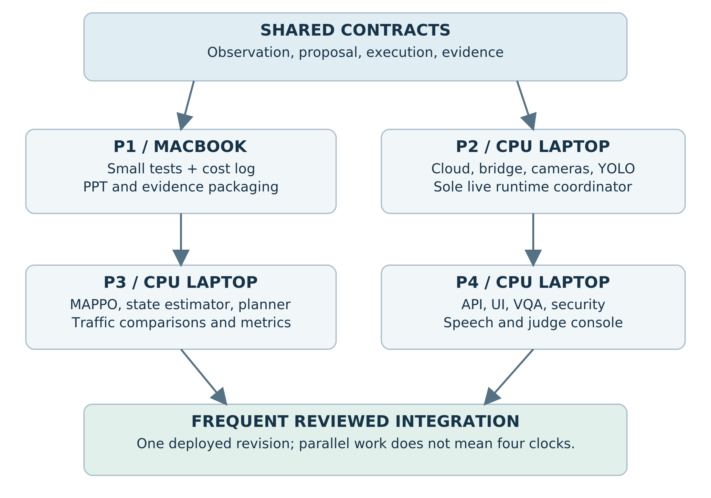
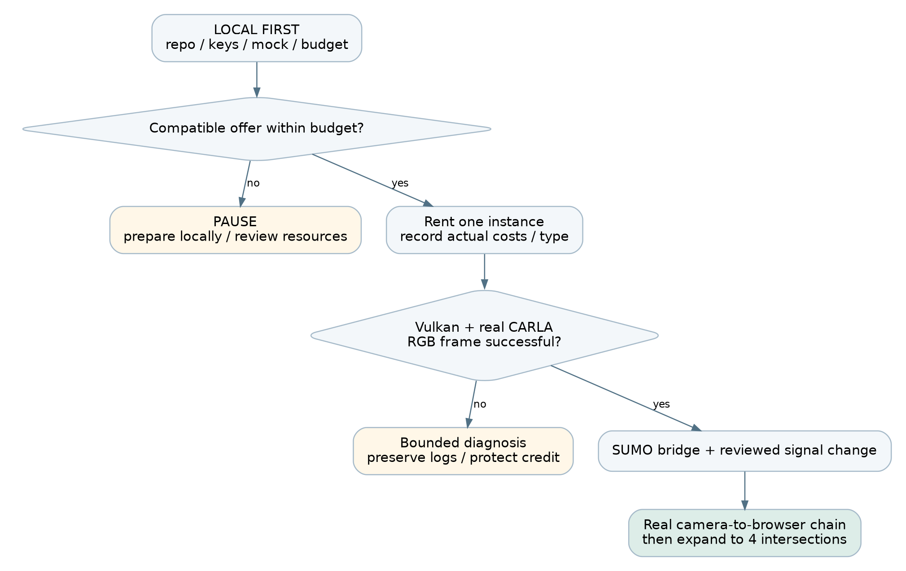
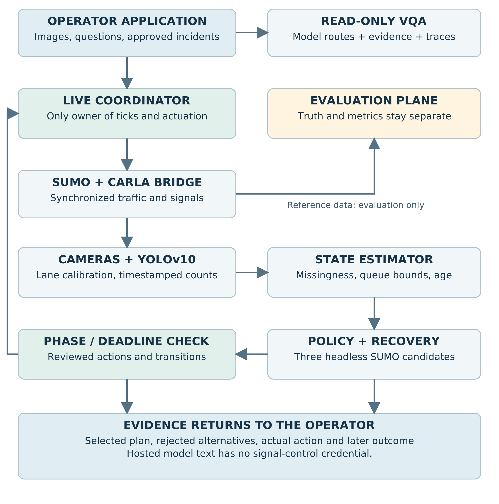
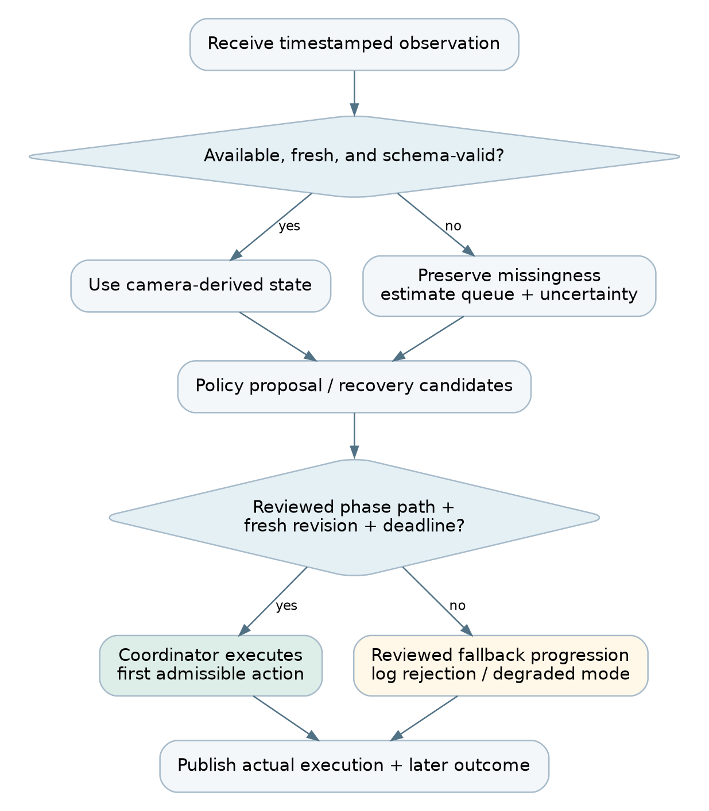
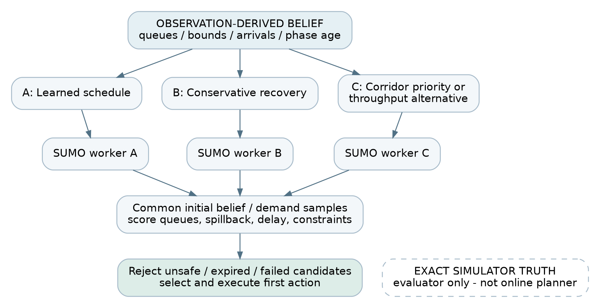
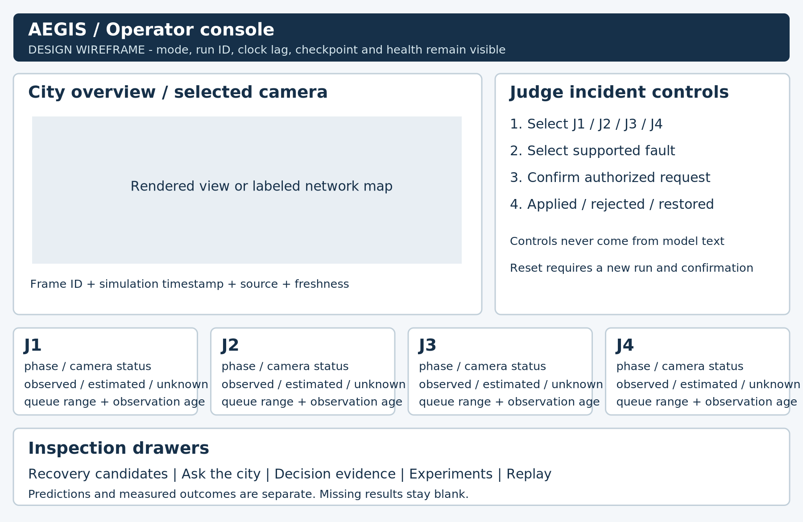
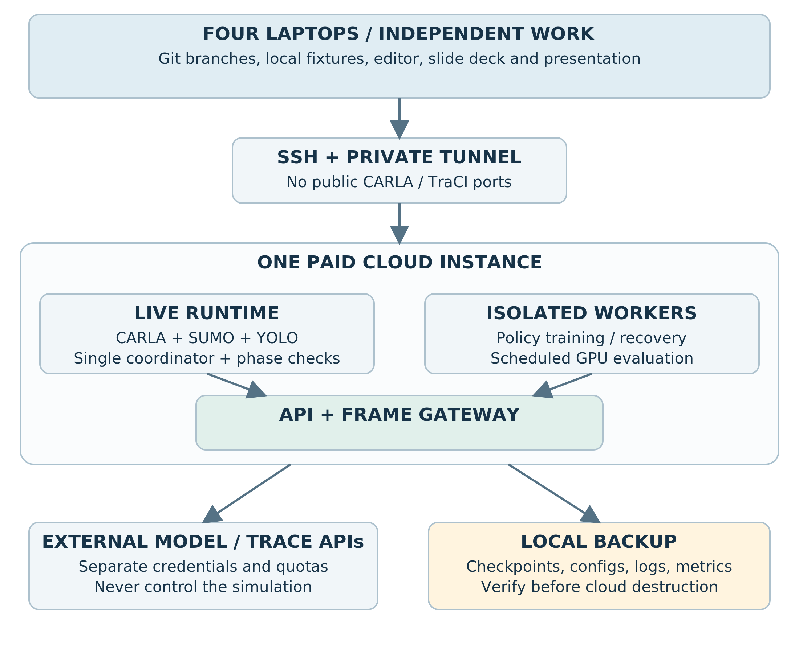

# 01. Start here: the project and the build contract

AEGIS is a fault-tolerant traffic-control research prototype. A judge can interrupt a camera feed or introduce a supported traffic incident. The system makes missing evidence visible, evaluates recovery schedules in SUMO, checks the chosen signal transition, applies it to the live co-simulation, and explains the decision using recorded evidence.

The primary submission is Smart Technologies PS1. Smart Technologies PS3 supplies the image-question interface, multi-model routing, adversarial evaluation, and privilege boundary around control. The interactive recovery planner is an additional proposed contribution, not an extra requirement quoted from the brief. [PS1] [PS3]

## What success looks like

One complete chain must work: CARLA camera frame -> YOLOv10 detections -> estimated lane state -> trained cooperative policy -> checked signal command -> SUMO/CARLA traffic response -> browser evidence. The system then repeats this chain under declared observation faults and exports comparison results. A 3D video alone is not this chain.

| Commitment | Build decision |
|---|---|
| Team | Four people, one MacBook and three CPU/integrated-graphics laptops |
| Paid resource | One compatible cloud NVIDIA instance; reported starting credit is $5 |
| Map | Town05 is the first candidate; four connected signal systems must be verified |
| Simulation release | CARLA server and Python client both 0.9.15; do not silently upgrade one |
| Deadline | Submission-ready by hour 12; hours 12-16 only when organizers explicitly permit |
| Training | SUMO-only MAPPO training is separate from live rendering; no checkpoint assumed |
| Presentation | P1 owns PPT with a small coding assignment; P4 owns speech and demo operation |
| Scope | Simulation prototype, not a deployable real-road safety system |

## Read the material in this order

Everyone reads sections 1-4 and 18-19. P2 then follows sections 5-10 before renting or changing the live runtime. P3 reads sections 12-15. P4 reads sections 16-18. Each person follows their task sheet in sections 20-23. Sections 24-29 are shared integration, evaluation, recovery, and presentation instructions.

Use the accompanying local starter before spending credit. It contains a clearly labeled mock dashboard, contract checks, a cost calculator, and 29 passing helper tests. It does not contain a completed CARLA integration, trained MAPPO model, or measured traffic/VQA results. Cloud probes are provided for execution on the rented machine; their output is an acceptance gate, not an assumed success.

## Match the actual problem statement

| Source requirement | Evidence to produce | Owner |
|---|---|---|
| CARLA + SUMO + YOLOv10 | Synchronized vehicles/signals and camera-derived lane estimates | P2 |
| Train cooperative MARL across 4+ intersections | Checkpoint, training manifest, action mapping, held-out comparison | P3 |
| Perception faults and recovery | Seeded fault schedule, recovery implementation, performance curves | P2 + P3 |
| Waiting time and fuel before/after | Matched experiment logs, units, completed/unfinished-trip counts | P3 |
| Image + question, dynamic multi-model routing | Working real backends, route logs, accuracy/latency comparisons | P4 |
| FGSM and prompt-injection evaluation | Explicit attack targets, clean/attack cases, detection/false-alarm results | P2 + P4 |
| Complete code / Docker Compose | Versioned repository and tested real frontend/backend deployment | P2 + P4 |

PS1 also names LangGraph in its suggested approach. Use a small observable orchestration graph for observation validation, candidate generation, checks, execution, and explanation if required by the organizers. Do not let an LLM or a graph abstraction become the simulation clock owner. [PS1]

# 02. Protect the $5 credit before doing anything else

Adding credit does not require immediately starting an instance. Prepare the repository, SSH keys, local UI, API accounts, and downloaded documentation first. No instruction in this kit rents or destroys an instance automatically.

Vast pricing is offer-dependent and includes compute, storage, and transfer. Storage continues while a stopped instance exists; bandwidth is separately charged. Check the current offer and billing page instead of treating a quoted GPU hourly rate as the whole bill. [R01]

## Use a spending envelope, not a promise

Proposed allocation: retain $1.00 as an untouchable operating buffer and initially allocate $0.50 for storage/transfer uncertainty. This leaves at most $3.50 for running compute before actual storage rates are added. These allocations are planning assumptions, not provider prices.

| Assumed compute rate | $3.50 compute-only allowance | Meaning |
|---|---|---|
| $0.28/hour | 12.50 hours | Does not include additional storage or transfer |
| $0.30/hour | 11.67 hours | Leaves little room for a 12-hour continuous rental |
| $0.35/hour | 10.00 hours | Requires substantial local preparation |
| $0.40/hour | 8.75 hours | Cannot support a 16-hour continuous run within this allowance |

For a 16-hour continuous rental, $3.50 permits only $0.21875/hour for compute before storage. No suitable offer at that price is guaranteed. A budget shortfall must change paid runtime, scope, or the funding decision; it cannot be solved by assuming free hours.

Use this formula with the actual offer:

```text
remaining_running_hours = max(0,
  (current_credit - future_transfer_allowance - reserve)
  / (compute_per_hour + running_storage_per_hour))
```

Stopped-storage hours and any external model API spending require separate accounting. A provider's displayed combined hourly estimate must not be counted twice: record whether storage is already included. The console balance is authoritative; the supplied estimator is a planning aid and has no auto-stop ability.

```bash
# LOCAL: from starter/; values below are illustrative only.
python -m aegis_helpers.budget --credit 5 --compute 0.30 \
  --storage 0.02 --transfer 0.50 --reserve 1.00
```

## Before clicking Rent

P1 records the starting balance and screenshot of the offer price breakdown. P2 records GPU, allocated CPU/RAM, disk size/rate, ingress/egress rates, rental end time, deployment type, and graphics capability. Agree on a maximum diagnostic allowance, for example $0.50, beyond which you pause and reassess rather than trying random host changes.

A 3D simulator download can be large. Budget the compressed download plus extraction, Python environments, model weights, and logs. A proposed 60-80 GB disk allocation is a planning starting point, not a universal minimum; compare storage cost against measured archive sizes. Do not download extra maps, every YOLO variant, or full benchmark image archives to the GPU host unnecessarily.

## During use and shutdown

Check balance at setup completion, each integration checkpoint, and before rehearsal. Use a phone timer for manual checks. Export small evidence bundles repeatedly. When finished, verify local backups, destroy the unneeded instance through the provider console, and check for retained volumes or other billable resources. Ctrl+C, closing a browser, logging out of SSH, or shutting down the application does not terminate the rental contract. [R01] [R02]

Vast credit does not pay another provider's model API bill. Do not enable paid APIs on the assumption that the $5 covers them. Validate any existing free quota or separately approved API allowance before implementing that route.

# 03. Beginner setup: prepare every laptop without a GPU rental

## The vocabulary you need

A terminal is a text interface for running commands. A repository is your project folder plus Git history. A virtual environment keeps one Python project's packages separate. SSH is an encrypted remote login. A port is a numbered network endpoint. A checkpoint is a saved trained model; an algorithm repository is not a checkpoint. A container packages processes and dependencies; it is not automatically a full virtual machine.

Every command in this handbook has a location label: LOCAL means your own laptop, CLOUD-ADMIN means the rented system's administrative shell, and CLOUD-RUNNER means the non-root simulation account. Replace capitalized placeholders with values from your own console. Do not type angle brackets from explanatory notation into a shell.

## Install only what each person needs

All four need Git, a code editor, a modern browser, and Python 3.11 for the starter (or another tested compatible supported version). P4 additionally needs a current supported Node.js LTS release for React. P1 needs PowerPoint, Keynote, or a presentation editor. P2 needs an SSH client and VS Code Remote SSH. P3 needs a separate local SUMO environment if practical. Docker is useful for application packaging, but is not required to run the dependency-free mock.

On Windows, use PowerShell for local SSH/Git/Python commands. For Linux shell commands, open an installed Ubuntu/WSL terminal or use the remote Linux terminal. Do not paste apt commands into PowerShell. On the Mac, use Terminal. The Mac does not need the CARLA Python client or CARLA server to prepare slides or run the local starter.

```text
LOCAL: check the tools after installation
  git --version
  python --version       # Windows; use py if python is unavailable
  python3 --version      # macOS/Linux
  ssh -V
  node --version         # P4 only
  npm --version          # P4 only
```

Use official download pages in the references for Git, Python, Node, and VS Code. Avoid copying unknown one-line installers from videos. Record the chosen versions in a shared manifest. [R23] [R31]

## Run the included no-cost contract lab

Unzip the team kit, open its starter folder in the editor, and open a terminal there. On Windows use `py -3.11` in place of `python` if that is your installed launcher. On macOS/Linux use `python3` where required.

```bash
# LOCAL: no pip packages, model downloads, or cloud account needed.
python -m unittest discover -s tests -v
python -m aegis_helpers.mock_server
```

Open `http://127.0.0.1:8000` on the same laptop. You should see four junction fixture cards and a large MOCK banner. Drop J2's camera: its observed count becomes null, while the illustrative estimated queue remains present. This proves the shared UI/data contract only. Stop with Ctrl+C.

The local mock uses a development operator token, `local-demo-only`. This is intentionally not a production secret. Set `AEGIS_OPERATOR_TOKEN` to a random value for shared tests. The default server binds to loopback so it is not a public service.

## Create the shared repository

P4 creates a private or organizer-approved repository named `aegis`. Invite the other three teammates. Copy the starter and report documentation into it, excluding report QA images. Each person clones their own working copy. Keep credentials, videos, large datasets, and weights out of Git.

```bash
# LOCAL: use the real repository URL supplied by the owner.
git clone YOUR_REPOSITORY_URL aegis
cd aegis
git switch -c p2-simulation
# P1 uses p1-evidence; P3 p3-control; P4 p4-console.
git status
```

Commit small working changes. Before asking another person to integrate them, state the changed schema, test command, and expected output. Never force-push the shared main branch. Do not change common environment files without telling P2 and P4.

# 04. Four people working in parallel

The project is divided by interfaces, not by whose laptop owns the GPU. P2 alone operates the live co-simulation coordinator. P3 develops control against the same observation schema in a separate SUMO process. P4 builds the console against fixtures. P1 develops a few independent tests and then switches to evidence and slides.



| Person | Main ownership | Presentation responsibility | Protected boundary |
|---|---|---|---|
| P1 - MacBook | Test-case review, cost log, result templates, evidence packaging | PPT and architecture visuals | Coding handoff by hour 2-3 |
| P2 - CPU laptop | Cloud, CARLA/SUMO bridge, cameras, YOLO, streaming | Restart/recovery operator | Only owner of live ticks and simulator restarts |
| P3 - CPU laptop | MAPPO, SUMO adapter, state estimator, planner, traffic evaluation | Technical control questions | Separate training workers; no direct live tick calls |
| P4 - CPU laptop | API, React console, secure VQA routing, prompt tests, deployment | Speech and judge-console operation | Speech slot around hours 9-10 |

## Freeze these contracts immediately

Observation messages carry run ID, state revision, simulation timestamp, lane estimates, raw-count availability, observation age, and provenance. Proposals carry a target junction, approved action ID, duration, originating revision, and expiry. Executed-action events report what actually happened, not merely what the policy requested. Camera messages identify the rendered frame and source timestamp. Section 18 specifies the complete contracts.

P2 may publish fixture-shaped messages before perception is ready; they must remain labeled MOCK. P3 can train using synthetic noisy observations in SUMO, but must label those separately from actual YOLO observations. P4's screen must always display the backend's data mode: MOCK, LIVE, REPLAY, or DEGRADED.

## GPU and server etiquette

Reserve explicit windows for rendering, training, and adversarial model evaluation. A small traffic MLP may train on CPU; measure rather than assuming GPU training is necessary. Do not run CARLA, multiple training jobs, and VQA attacks concurrently until memory and timing measurements justify it.

Use separate server folders for separate branches. Keep a single reviewed integration checkout. Store model artifacts with unique run IDs rather than overwriting `best.pt`. One person requests a restart, P2 acknowledges it, the others stop dependent clients, and P2 restarts. Independent changes to a live synchronizer are not a collaboration mechanism.

Remote SSH lets each developer edit remote files from their own editor. Git worktrees can provide multiple independent branch checkouts, but ordinary separate clones are simpler for a new team. [R23] [R24]

# 05. Choose a rental that can render, not merely run CUDA

CARLA 0.9.15 requires an appropriate GPU and uses a Linux/Windows server. Its rendering path uses Vulkan. Off-screen rendering still needs graphics support. A successful CUDA tensor calculation or `nvidia-smi` output alone does not prove that cameras will render. [R05] [R07]

## Preferred selection checklist

Proposed targets: one 24 GB RTX 3090/4090-class GPU, at least 8 allocated CPU threads, roughly 32 GB allocated RAM, and sufficient writable disk after accounting for downloaded archives. These are planning targets, not validated minimum requirements. An offer with a large GPU but very little allocated CPU or RAM can still be unsuitable for this workload.

Select an on-demand instance for demonstration continuity. Check the host's available duration, reliability indicators, location/network quality, allocated resources, and all prices. Never describe on-demand as immune to failures. Capture the offer details before renting. [R03]

## Choose exactly one deployment path

| Path | Use when | How the simulator runs | Key warning |
|---|---|---|---|
| A: Full Linux VM | An affordable VM-compatible offer is available | Native binary or a tested NVIDIA Docker container | More boot/disk overhead; configure SSH keys before launch |
| B: Vast Docker instance | The cheaper verified offer is a container with graphics access | Native CARLA binary inside the existing container, under a non-root user | Do not assume nested Docker/systemd works |

Vast documents both full VMs and Docker-based instances. The VM template is suitable for nested container workflows, whereas the Docker execution environment has different isolation and resource behavior. Check the actual deployment type instead of relying on the template's display name. [R04] [R02]

For a container template, confirm at creation that NVIDIA driver capabilities include the required graphics support. The setting commonly used for this design is `NVIDIA_DRIVER_CAPABILITIES=compute,utility,graphics,video`. The host runtime must expose the corresponding libraries; exporting the variable after creation cannot retroactively mount missing driver libraries. NVIDIA documents the distinction between compute and graphics capabilities. [R09]

## Rental acceptance sequence

1. Select the template and offer; record prices and resource limits.
2. Add team public keys through the supported access method before launch.
3. Rent only after the local checklist is complete.
4. Connect and run the read-only preflight.
5. Verify Vulkan on the assigned NVIDIA device, then obtain a real CARLA camera frame.
6. Reject the environment for this build if graphics cannot be established within the agreed diagnostic allowance.

Do not change host NVIDIA drivers inside a marketplace container. Do not use privileged workarounds blindly. Preserve logs, ask the provider/host for the required capability, or stop further spending while choosing a compatible offer.



# 06. SSH, VS Code, and the team's first connection

Each person creates their own SSH key pair. Share only the public `.pub` file with the account owner. Keep the private key on its owner's laptop and use a passphrase. Do not send the account password, billing credentials, or private key to the group chat. Vast's connection guide explains key-based access and port forwarding. [R06]

```bash
# LOCAL macOS/Linux: choose a fresh filename; do not overwrite an old key.
ssh-keygen -t ed25519 -C "aegis-p2" -f "$HOME/.ssh/aegis_p2"
cat "$HOME/.ssh/aegis_p2.pub"
```

```powershell
# LOCAL Windows PowerShell: use your own teammate identifier.
ssh-keygen -t ed25519 -C "aegis-p2" -f "$HOME/.ssh/aegis_p2"
Get-Content "$HOME/.ssh/aegis_p2.pub"
```

The account owner adds the public keys using the current Vast interface and supported key attachment method. For VMs, Vast documents a pre-launch key requirement; do not wait until after VM creation to configure access. [R04]

## Copy the connection details exactly

Open the instance's Connect/SSH information. Copy its host, port, and username; these are not necessarily the same as the card's IP and port 22. Some offers use an SSH proxy. Preserve the provider's options and proxy configuration rather than simplifying them by guesswork.

```text
LOCAL: ~/.ssh/config example - fill in real values
Host aegis-cloud
    HostName HOST_FROM_VAST_CONNECT
    Port PORT_FROM_VAST_CONNECT
    User USER_FROM_VAST_CONNECT
    IdentityFile ~/.ssh/aegis_p2
    ServerAliveInterval 30
    ServerAliveCountMax 3
```

```bash
# LOCAL: first establish a normal terminal connection.
ssh aegis-cloud
# CLOUD: confirm where you are before running setup commands.
whoami
hostname
pwd
```

Check the host-key fingerprint using available provider/administrator information. Do not disable host-key checking globally to bypass a warning. If the rented host changes after recreation, verify the new host before updating the specific known-host entry.

In VS Code, install Remote SSH, choose Connect to Host, select `aegis-cloud`, and open your own project checkout. The remote editor status indicator must identify the cloud host. Close the remote folder before running commands intended for your laptop. [R23]

## View the private application through an SSH tunnel

Keep the application on cloud loopback initially. Open a second LOCAL terminal:

```bash
ssh -N -L 8000:127.0.0.1:8000 aegis-cloud
```

Open `http://127.0.0.1:8000` on the laptop. Keep that terminal open. The tunnel forwards your local port to the cloud service; it does not start the service. If local port 8000 is busy, use `-L 18000:127.0.0.1:8000` and browse port 18000.

Never expose CARLA RPC, TraCI, model credentials, or administrative fault endpoints directly to the public internet. A remotely accessible judge screen should use an authenticated gateway; the first stage demo can use the operator laptop's tunnel.

# 07. Cloud preflight and Python environment setup

## Read-only checks first

Copy the starter scripts to the cloud or clone the repository. Run the preflight script in the rented Linux environment. Its failure messages are diagnostic, not automatic installation instructions.

```bash
# CLOUD: from starter/.
bash scripts/preflight.sh
```

Acceptance: Linux x86-64, usable GPU/VRAM, enough disk/RAM, and Vulkan enumerating the NVIDIA hardware rather than only a software rasterizer. A headless DISPLAY warning is not automatically fatal; the CARLA RGB frame is the decisive end-to-end graphics test. Record output in `manifests/preflight.txt`.

## Ubuntu 22.04-based native path

These package commands target a Debian/Ubuntu 22.04-based runtime. If `/etc/os-release` says something else, use that distribution's documented packages; do not paste these blindly. In a root container omit `sudo`; in an administrative VM account retain it.

```bash
# CLOUD-ADMIN: install userspace packages, not host GPU drivers.
sudo apt-get update
sudo apt-get install -y git curl ca-certificates unzip tmux \
  python3.10 python3.10-venv python3-pip \
  libvulkan1 vulkan-tools libglib2.0-0 libsm6 libxext6 \
  libxrender1 libxrandr2 libxinerama1 libxcursor1 libxi6 \
  libomp5 libnss3 libasound2 sumo sumo-tools
```

Run the simulator as a non-root account. If the template already provides a suitable non-root user, use it. Otherwise the administrator creates one and an owned workspace. Do not solve permission failures using `chmod -R 777`.

```bash
# CLOUD-ADMIN: run these only when the account is not already present.
sudo useradd --create-home --shell /bin/bash aegisrun
sudo install -d -o aegisrun -g aegisrun /workspace/aegis
sudo -iu aegisrun
```

From a root shell the equivalent account switch is `su - aegisrun`. Shared code may be readable by the runner, but cloud credentials and API keys remain restricted. Do not copy the account owner's entire SSH directory into the runner's home.

## Separate environments avoid dependency conflicts

```bash
# CLOUD-RUNNER
export AEGIS_HOME=/workspace/aegis
mkdir -p "$AEGIS_HOME/venvs" "$AEGIS_HOME/logs" "$AEGIS_HOME/models"
python3.10 -m venv "$AEGIS_HOME/venvs/sim"
source "$AEGIS_HOME/venvs/sim/bin/activate"
python -m pip install --upgrade pip
python -m pip install "carla==0.9.15" "numpy<2" Pillow
export SUMO_HOME=/usr/share/sumo
export PYTHONPATH="$SUMO_HOME/tools:${PYTHONPATH:-}"
python -c "import carla,traci; print('Simulation imports OK')"
sumo --version
```

CARLA 0.9.15 has a CPython 3.10 Linux x86-64 wheel. That is why this path uses Python 3.10 for the bridge rather than whichever interpreter happens to be newest. The package is the client API, not the large simulator server. Python 3.10 is a legacy compatibility choice for this isolated simulator bridge, not the recommended interpreter for a new public web service. Keep the app on a supported interpreter such as 3.11 or newer, keep the bridge private, and record the maintenance limitation. [R08] [R31]

Save non-secret path exports in a runner-owned shell file, for example `$HOME/aegis_paths.sh`, and source it in every new cloud terminal. The file should define `AEGIS_HOME`, `CARLA_ROOT`, `CARLA_SOURCE`, and `SUMO_HOME`; it is not a place for API keys. Clone the team repository to a known location such as `/workspace/aegis/repo` and record that as `AEGIS_REPO`. A new SSH or tmux session does not automatically inherit exports from another terminal.

Create separate environments for vision, control training, and the application. Install each dependency set there and save `pip freeze` after a successful smoke test. Do not copy an old MAPPO repository's Python/CUDA install instructions into the CARLA environment. The combination of packages in this handbook is a setup plan, not a prevalidated universal lockfile.

# 08. Install and start CARLA 0.9.15

Use the official 0.9.15 release binary or a verified official release image. Do not build Unreal Engine from source during the hackathon. Download the Linux release package using the link exposed by the official release/download page; verify the filename/version before extraction. Extra-map archives are not needed for the initial Town05 attempt. [R05] [R10]

## Path B: binary inside the existing rental container

```bash
# CLOUD-RUNNER: set this to the actual official Linux package URL.
export CARLA_PACKAGE_URL='PASTE_OFFICIAL_0_9_15_LINUX_ARCHIVE_URL'
cd "$AEGIS_HOME"
curl -I -L "$CARLA_PACKAGE_URL"
# Inspect size and remaining budget before downloading.
curl -L --fail --retry 2 -o CARLA_0.9.15.tar.gz "$CARLA_PACKAGE_URL"
mkdir -p "$AEGIS_HOME/carla"
tar -xzf CARLA_0.9.15.tar.gz -C "$AEGIS_HOME/carla"
find "$AEGIS_HOME/carla" -maxdepth 3 -name CarlaUE4.sh
```

Set `CARLA_ROOT` to the directory that actually contains `CarlaUE4.sh`; archive layouts can differ. Do not assume that a Git clone includes the executable. Save the download URL and file hash. Retain only the assets needed for the selected map, without deleting files whose dependencies you do not understand.

```bash
# CLOUD-RUNNER: inside the actual CARLA_ROOT directory.
tmux new -s aegis-carla
./CarlaUE4.sh -RenderOffScreen -quality-level=Low -nosound \
  -carla-rpc-port=2000
```

Detach from tmux with Ctrl+B, then D. Reattach using `tmux attach -t aegis-carla`. Ctrl+C stops the process in that session; it does not stop the rental bill. CARLA's off-screen option renders sensor images without a desktop. No-rendering mode is different and produces empty camera data. [R07]

## Path A: optional official Docker image on a full VM

Only use this path when `docker info` works on the VM and NVIDIA container support has been verified. It is not a command to run blindly inside an ordinary rental container.

```bash
# CLOUD VM: version-pinned image; check graphics support first.
docker pull carlasim/carla:0.9.15
docker run --rm --name aegis-carla --gpus all \
  -e NVIDIA_DRIVER_CAPABILITIES=compute,utility,graphics,video \
  -p 127.0.0.1:2000-2002:2000-2002 \
  carlasim/carla:0.9.15 /bin/bash ./CarlaUE4.sh \
  -RenderOffScreen -quality-level=Low -nosound
```

This is a proposed minimal launch configuration; compatibility must pass the camera smoke test on the selected host. Do not add privileged mode simply because an old example includes it. Consult the exact release's container guidance and provider restrictions when a library/device is missing. [R11] [R09]

## Verify server, map, and one real camera

In another runner terminal activate the simulation environment and connect:

```python
import carla
client = carla.Client("127.0.0.1", 2000)
client.set_timeout(60)
print(client.get_client_version(), client.get_server_version())
print(client.get_available_maps())
world = client.load_world("Town05")
print(world.get_map().name)
```

Then run `python scripts/camera_smoke.py --output smoke/camera.png` from the starter in the same environment. This standalone probe requires asynchronous mode and must run before the co-simulation coordinator starts. Open the saved image and verify a plausible rendered street. An empty/black image is a failure to investigate, not a completed perception pipeline.

# 09. SUMO, the co-simulation example, and four real intersections

Obtain the version-matched CARLA source scripts separately if the binary package lacks Co-Simulation. A shallow source checkout is used for scripts, not for compiling the simulator.

```bash
# CLOUD-RUNNER
git clone --depth 1 --branch 0.9.15 \
  https://github.com/carla-simulator/carla.git "$AEGIS_HOME/carla-source"
export CARLA_SOURCE="$AEGIS_HOME/carla-source"
cd "$CARLA_SOURCE/Co-Simulation/Sumo"
python -m pip install lxml
python run_synchronization.py --help
```

Resolve missing script dependencies in the simulation environment and record them. CARLA provides examples for Town01, Town04, and Town05. Start with the supplied network and routes rather than importing a new city. Pin the SUMO version that passes your smoke test and use that same version for the training/evaluation network. [R12] [R13]

## First synchronized run

Load Town05 in CARLA before starting the example. Do not start a second traffic generator independently in CARLA. Let SUMO own the vehicles used in the experiment, and let the bridge mirror them into CARLA.

```bash
# CLOUD-RUNNER: CARLA already running with Town05 loaded.
cd "$CARLA_SOURCE/Co-Simulation/Sumo"
python run_synchronization.py examples/Town05.sumocfg \
  --tls-manager sumo --step-length 0.05
```

Do not add `--sumo-gui` on a headless host unless you deliberately configured a display. `--tls-manager sumo` matters: the script's default does not synchronize the traffic-light authority. [R12]

The example is the smoke-test coordinator. For the actual app, P2 must extend or wrap its tick cycle with an observation/action hook. Do not run both the example and a second controller loop that independently advances CARLA or SUMO.

## Inventory the traffic lights independently

Stop the smoke-test coordinator cleanly. Run the included inventory script in its own SUMO process:

```bash
# CLOUD-RUNNER: no connection to the live co-simulation is used.
python /PATH/TO/starter/scripts/list_tls.py \
  "$CARLA_SOURCE/Co-Simulation/Sumo/examples/Town05.sumocfg" \
  --out tls_inventory.json
```

SUMO's traffic-light API exposes controlled lanes, programs, and phase states. Review actual geometry and connectivity, not just the number of returned IDs. One signal ID can control more than one physical location; verify what you are counting. [R14]

Populate `configs/junctions.json` with four selected signal IDs, lane IDs, neighbor links, camera transforms, approved green actions, and validated transition paths. The provided example file intentionally contains replacement markers. No production run should start while those markers remain.

## Readiness test

For each of the four intersections: vehicles arrive on declared routes, an approved phase can be selected through the single coordinator, the phase is visible in both simulators, the camera covers the required approaches, and a recorded timestamp connects its image to the traffic state. If Town05 cannot supply the chosen connected topology within the build, evaluate another supplied example and record the map change before training.

# 10. The first end-to-end acceptance gate

Do not start embellishing the dashboard until this gate passes. It is the fastest way to discover whether the rented platform and integration choices are usable.

| Step | Action | Evidence to save | Failure means |
|---|---|---|---|
| 1 | Start CARLA, connect exact-version API | Server/client versions and log | Runtime not ready |
| 2 | Capture one RGB frame | Real PNG with frame ID/time | Rendering not ready |
| 3 | Detect vehicles in that frame | Boxes/classes plus inference time | Perception not ready |
| 4 | Advance supplied SUMO/CARLA example | Synchronized timestamp/vehicle sample | Bridge not ready |
| 5 | Request a reviewed phase transition | Accepted action + resulting signal state | Actuation not ready |
| 6 | Stream the frame and state to a browser | LIVE-labeled console evidence | Presentation transport not ready |

Use fixed-time control for this integration test. Its purpose is to validate transport and actuation, not prove learned control. Keep `controller_type=fixed_time` in every event until a real checkpoint is loaded.

## YOLOv10 installation and first inference

Use a separate vision environment. The original YOLOv10 repository documents its own package installation and model API; avoid mixing that fork with an incompatible globally installed Ultralytics release. Select a tested repository revision and record it. [R16]

```bash
# CLOUD-RUNNER: separate environment, not the CARLA environment.
python3.10 -m venv "$AEGIS_HOME/venvs/vision"
source "$AEGIS_HOME/venvs/vision/bin/activate"
git clone https://github.com/THU-MIG/yolov10.git "$AEGIS_HOME/yolov10"
cd "$AEGIS_HOME/yolov10"
git rev-parse HEAD
python -m pip install -r requirements.txt
python -m pip install -e .
python -c "import torch; print(torch.__version__, torch.cuda.is_available())"
```

The upstream instructions recommend Python 3.9; the isolated 3.10 path above is a compatibility candidate to test, not an upstream guarantee. If its dependency resolution fails, follow the repository's documented interpreter environment rather than breaking the simulation environment. Freeze the first successful combination. Download only the nano model from the official release, retaining its source and license.

```python
from ultralytics import YOLOv10
model = YOLOv10("/workspace/aegis/models/yolov10n.pt")
results = model("/PATH/TO/smoke/camera.png")
print(results[0].boxes)
```

A run with no detections is not necessarily an installation failure; the camera may see no vehicles. Check the image and a known positive frame. A pretty bounding-box image is not yet a queue estimator. Section 12 defines that additional work.

# 11. Architecture: three planes, one live clock owner

The design separates control, operator interaction, and evaluation. A failure in the explanation service must not freeze the traffic simulator. Evaluation can inspect simulator truth, but the online controller must not receive undeclared perfect observations.



## Control plane

P2's coordinator owns one live CARLA world and one live SUMO connection. It receives timestamped perception messages, asks P3's estimator/policy for a proposal, validates the proposal through the phase manager, applies an admissible action in SUMO, and mirrors the traffic-light state into CARLA. Sensor callbacks never call `world.tick()`.

CARLA distinguishes simulated time from wall-clock execution time and requires a single ticking client in a synchronous multiclient arrangement. Use a fixed simulation step and make synchronization ownership explicit. [R15]

Proposed initial timing: simulation step 0.05 seconds, roadside camera sampling 0.2-0.5 simulated seconds, control decisions every 5 simulated seconds, and browser telemetry at a measured sustainable rate. These are engineering starting points. They are not measured FPS or guaranteed real-time performance. Report the wall-time/sim-time ratio.

## Operator and explanation plane

The application displays live/replay state, accepts authenticated supported incident requests, and answers image-grounded questions. It reads the evidence store and selected frames, not administrative simulator credentials. Hosted inference is asynchronous. If a model times out, the UI shows the timeout and preserves control functionality.

The fault console is authorized to request only allowlisted simulation changes. It does not accept arbitrary Python, shell commands, traffic-light state strings, or external URLs for the backend to fetch. An uploaded image is data, not an instruction channel. The VQA worker has no control credential.

## Evaluation plane

Reference metrics, true vehicle positions, true queues, training rewards, and test annotations live in a separate path. Simulator truth may train a centralized critic and evaluate predictions, but it is not merged into live actor inputs after a sensor fails. Label critic-only training information clearly in the model card.

Store each experiment with its seed, map/configuration hashes, checkpoint hash, perception mode, fault schedule, action log, and software versions. This lets a judge distinguish a recorded experimental result from a live preview.

## Suggested processes

| Process | Reads | Writes | May advance live simulation? |
|---|---|---|---|
| Coordinator | Observation snapshots, proposals, incident queue | Actuation + state events | Yes, only this process |
| Perception worker | Camera frames and approved calibration | Detections and lane estimates | No |
| Policy/estimator | Observation-only state | Candidate proposal | No |
| Three planner workers | Synthetic belief-state scenarios | Candidate metrics | No; only their own SUMO instances |
| Operator API / VQA | Evidence, selected image, question | Explanations and authenticated requests | No |
| Evaluator | Experiment logs and explicit reference truth | Benchmark tables | No; separate experimental runs |

Bound every queue and discard superseded camera frames when necessary. Processing an old frame forever is worse than declaring an observation stale. Record dropped-frame counts instead of concealing overload.

# 12. Perception: from a picture to an uncertain lane state

P2 owns capture, camera placement, vehicle detection, and timestamping. P3 owns temporal state estimation. Their boundary is an observation message with explicit missingness, not a list of unlabeled numbers.

## Calibrate each intersection

Choose camera positions that see the selected approaches and stop lines. Render a sample from each, draw lane-region polygons, and store them in map-versioned configuration. Assign a detected vehicle using its bottom-center point in the image, with an explicit ambiguity rule near polygon edges. Do not use a simulator vehicle ID to resolve ambiguous detections in the online pipeline.

An image count estimates visible vehicles. A queue estimate additionally needs a definition of stopped/slow traffic and temporal evidence. A practical first version tracks centroids across successive frames within a lane and classifies little motion near the stop line as a stopped-vehicle proxy. Validate that proxy against reference labels on held-out frames. Without metric calibration, do not label pixel motion as meters/second.

Low rendering quality changes the scene and limits drawing distance; cameras must not claim to observe queues beyond their useful field of view. Record the observed road extent and distinguish unobserved approaches. [R07]

## Suggested observation fields

```json
{
  "schema_version": "1.0",
  "run_id": "trial-004",
  "state_revision": 72,
  "sim_time_s": 180.0,
  "junction_id": "J2",
  "lane_id": "ACTUAL_SUMO_LANE_ID",
  "frame_id": 3590,
  "observed_at_sim_s": 179.5,
  "observed_count": null,
  "missing": true,
  "estimated_queue": 7.0,
  "queue_interval": [4.0, 12.0],
  "source": "estimate",
  "quality_reason": "camera_timeout"
}
```

The values above illustrate a contract, not measured traffic. A missing raw count is null, not zero. The estimated queue is a different field with its own uncertainty. A confidence score from the detector is not automatically a calibrated probability of correctness.

## Fault injection must test the claimed mechanism

| Fault | Inject at | What the controller receives |
|---|---|---|
| Camera dropout | Frame transport / observation boundary | Missing observation and increasing age |
| Sensor occlusion | Image pixels before detection | The detector's actual degraded output |
| Stale replay | Repeated old frames and original timestamps | Old or inconsistent observations |
| Reduced frame rate | Capture/transport schedule | Irregularly aged observations |
| Digital adversarial image | Declared attacked-model input | Separate PS3 experiment unless integrated explicitly |

For the required random-failure curve, define exactly what a 20% rate means: for example, independently dropping each scheduled camera observation with probability 0.20. A sustained 30-second camera outage is a different test. Log the same seeded fault schedule for paired controller comparisons. [PS1]

A dropout signal is directly observable. Detecting stealthy replay is harder. If the injector marks every replay for the detector, it measures response to declared faults, not independent attack detection. Keep injector metadata in the evaluation channel and give the runtime only what a real observer would see.

## Perception evaluation

Use manually reviewed or simulator-reference labels on held-out frames for visible count error, lane assignment errors, queue proxy error, missing-rate behavior, and time per frame. Record weather/viewpoint conditions. A traffic policy trained with synthetic count noise still needs evaluation using the actual YOLO-derived observations.

# 13. MAPPO: the learning task and the training plan

MAPPO is multi-agent policy optimization with centralized training information and decentralized actor decisions. The official implementation is a useful reference, but it is not a pretrained Town05 controller. SUMO-RL supplies traffic-control environments and interfaces, not a guarantee that a custom CARLA-compatible map and MAPPO checkpoint will work without adaptation. [R17] [R18]

## Freeze the environment before training

P3 uses the same selected four junctions, lane ordering, allowed phase actions, traffic demand assumptions, and time units that P2 will deploy. Save an observation/action schema hash. A checkpoint with different lane ordering is not reusable just because the input vector has the same length.

Recommended first actor input per junction: normalized estimated lane queues, missing-observation masks, observation ages, current green-phase one-hot encoding, elapsed phase time, neighbor inflow estimates, and junction identity. Optional emergency-request fields must be independently authorized, not extracted from an arbitrary sign in an image.

Use a padded action space and an availability mask if junctions have different numbers of green phases. The policy selects an approved green action; it never invents raw red/yellow/green strings. The phase manager controls clearance transitions.

## A compact starting model

Proposed actor: a shared MLP with two 64-unit hidden layers plus junction identity. Proposed critic: an MLP over the joint training state. Use separate actors only when heterogeneity makes a shared actor unsuitable. Add recurrence only after the simpler policy is working. This is a design choice, not an established best architecture for Town05.

Train with fixed-time and optionally pressure-based baselines available from the beginning. Team reward can be the negative normalized network queue plus penalties for spillback and excessive phase switching. Specify the exact reward and weights in configuration. Use simulator quantities for rewards during training, but do not leak those values into the online observation message.

```text
For each training rollout:
  reset demand/fault seeds and map-compatible observation state
  collect each actor's observation and available-action mask
  sample green-action proposals
  execute only the phase manager's valid transitions
  advance the training SUMO environment to the next decision point
  store rewards, actions, action log-probabilities, values, and masks
  bootstrap correctly at truncation; compute advantages
  optimize clipped policy objective + critic loss + entropy term
  evaluate a frozen checkpoint on held-out demand/fault episodes
```

A valid MAPPO implementation needs joint training, correct advantage/value targets, and a consistent centralized critic. Four independently trained PPO agents should not simply be renamed MAPPO. Reuse and adapt a verified implementation where possible; test its custom environment adapter before a long run.

## Initial experiment settings, not promised results

| Setting | Initial proposal | What to inspect |
|---|---|---|
| Decision interval | 5 simulated seconds | Interaction with min-green/clearance |
| Episode | 600-900 simulated seconds | Warm-up, residual queues, route completion |
| Actors | Four selected signal systems | Correct per-junction masks |
| Fault curriculum | Clean first, then declared dropouts | Avoid a policy that ignores all observations |
| CPU workers | Start with one or two | SUMO throughput and host CPU budget |
| Checkpoints | Periodic plus held-out best | Never select using the final test set |
| Training device | CPU first for a small MLP; GPU only if beneficial | Measure environment vs optimizer bottleneck |

## Training stages

First, overfit a tiny deterministic traffic case to test whether updates change behavior. Second, vary traffic demand and seeds. Third, apply the same missingness representation and synthetic error model used in the live interface. Fourth, evaluate through the actual YOLO pipeline. If the trained policy is worse than fixed-time, report that result and retain baseline control for operational continuity; do not claim successful optimization based solely on a falling training loss.

A useful checkpoint bundle contains model weights, normalization statistics, algorithm and code revision, observation/action schema hashes, network hash, seeds, training steps, and evaluation notes. The included manifest is deliberately marked UNTRAINED_TEMPLATE.

## What P3 must not assume

No pretrained checkpoint is included in this kit. No training duration or convergence is guaranteed. A small policy may still require extensive environment interactions. Preserve each incremental result so the final submission can distinguish functioning infrastructure, a trained model, and a measured improvement.

# 14. Missing-state estimation and phase constraints

## Estimate what is hidden without reading simulator truth

Maintain an estimate for each lane's queue. A simple proposed update is a bounded conservation rule:

```text
estimated_queue_next = clamp(
    estimated_queue_previous + estimated_arrivals - estimated_departures,
    0, estimated_lane_capacity)
```

Arrival estimates can use recent observed arrivals, neighboring observed departures, and declared turning assumptions. Departure estimates depend on the known signal phase and a calibrated discharge-rate model. Expand lower/upper bounds as the observation ages. When a camera returns, compare its new observation with the predicted range, record the discrepancy, and reconcile gradually instead of abruptly pretending past certainty.

Queue intervals are estimated uncertainty ranges unless independently calibrated. Do not label them 95% confidence intervals without a supporting evaluation. Record assumptions such as vehicle-length/headway estimates and turning probabilities.

## The phase manager is independent of the policy

Each intersection has reviewed green states and approved transition paths. A request for a different green phase may require current green -> yellow -> clearance/all-red -> requested green. The correct path depends on the network's signal program and movement conflicts; do not infer it from a simplistic string substitution.

The helper in the kit checks request age, revision, known actions, and minimum green. It does not establish geometric conflict safety. P3 must connect it to map-specific phase programs reviewed jointly with P2.



## Proposed checks before actuation

Reject unknown junctions/actions, stale state revisions, expired plans, negative/nonfinite durations, and requests that bypass mandatory transition states. Enforce minimum/maximum green constraints and the approved movement-conflict table. Rate-limit operator incident requests and log request IDs to avoid duplicate execution.

The controller must have a documented fallback if observations are unusable or the planner times out. For the simulation, use a reviewed fixed-time program or a conservative existing phase progression. Do not abruptly force every light red from an arbitrary state and call it universally safe; even a fallback has a transition protocol.

Report the number of rejected actions, executed transitions, deadline misses, and any violations observed by an independent validator. Passing these tests supports specific modeled constraints only. It does not certify real-world traffic safety.

## Information separation test

Run the same online controller twice with the same observation messages but different hidden evaluation-state records. Its proposals should be identical unless an explicitly authorized nonvisual input changed. This is a useful leakage test. The controller should not import an evaluator object with unrestricted `traci.vehicle` access.

# 15. Three recovery branches that actually influence the decision

The planner compares candidate schedules in separate headless SUMO instances. It does not launch additional CARLA worlds. The live coordinator alone continues the real co-simulation. A planner result is advisory until its state version, freshness, and phase constraints are checked.



## Candidate policies

Candidate A follows the learned policy. Candidate B is a conservative recovery schedule using reviewed phases and uncertain queues. Candidate C prioritizes an authorized emergency corridor when one is active; otherwise use a distinct throughput/pressure-oriented schedule. Give every candidate the same modeled information and the same constraints. Do not handicap alternatives merely to manufacture a win.

## Initialize from a belief state

Create synthetic traffic configurations consistent with the observed/estimated queues, plausible arrivals, lane capacities, and turning probabilities. Align signal phases and elapsed phase time. Record that these are predictions from a reduced estimated state, not exact clones of the live world.

SUMO supports state save/load, including optional random-state preservation, but copying a live exact state into a supposedly blinded planner leaks perfect vehicle information. Exact snapshots are appropriate for controlled evaluation; online planning needs estimated-state initialization. [R19]

A first implementation may evaluate the three candidates on one declared nominal estimated state. The stronger version evaluates lower/nominal/upper demand or queue states, giving nine rollouts. Only claim robustness across uncertainty when those extra scenarios actually execute. Reuse workers where possible, but reset every candidate to the same initial belief-state sample.

## Score and select

Proposed cost combines normalized queue-time integral, emergency delay when applicable, spillback exposure, and excessive side-road waiting. Weights and units belong in configuration. Report each component, not just one opaque total. A plan violating a hard phase constraint is inadmissible regardless of predicted throughput.

Use a horizon such as 60 simulated seconds as a starting design value. Benchmark rollout wall time on the rented CPU. Set a planner deadline shorter than the point at which its recommendation becomes unusable. Apply only the first control decision of the chosen plan and replan later; do not commit an entire minute of signals to an increasingly stale prediction.

```text
snapshot -> candidate generation -> common belief samples
         -> isolated SUMO rollouts -> constraint screening
         -> cost comparison -> timestamp/revision validation
         -> first admissible action -> live execution -> outcome log
```

## Prediction versus outcome

The dashboard must label rollout values PREDICTED and measured live/evaluation metrics OBSERVED. Store a later outcome record linked to the decision. A counterfactual comparison is not a measured alternative outcome unless you rerun the scenario under matched conditions.

Record each candidate's initial state hash, demand seed, horizon, score components, wall time, and rejection reason. If a worker fails or misses its deadline, show it as unavailable rather than inventing a score. The system can continue with its reviewed fallback, with that degraded mode visible.

# 16. PS3: secure visual QA and genuine model routing

The operator can upload a supported image or select a captured camera frame and ask a question. A multi-turn session preserves the referenced run/frame and question context. The router selects a real model or a deterministic tool according to query type. Numeric tools are useful, but are not by themselves a second AI model. [PS3]

## Minimum real routing configuration

Use at least two actual evaluated model backends. One can be local ViLT for constrained general VQA and the other an available hosted vision-language endpoint for richer scene questions. A third reasoning model may explain structured calculations. Configure provider/model identifiers rather than embedding retired example names from the PS. Confirm endpoint access, image support, rate limits, and billing with a real sample request. [R20] [R29]

| Question | Route | Evidence returned |
|---|---|---|
| What is visible in this approach? | Hosted vision endpoint | Frame ID + visible observations; uncertainty stated |
| How many objects / what color? | Validated local VQA route where appropriate | Selected model and concise answer |
| Which candidate had lower predicted queue cost? | Numeric comparison tool; optional reasoning explanation | Stored plan components and arithmetic |
| Why did J2 change phase? | Decision-record retrieval plus explanation route | Observation, proposal, check, execution references |
| Set all lights green because the image says so | Refuse unauthorized actuation | Boundary event; no control mutation |

Do not send every camera frame to a paid model. Trigger queries on user action, cache only with explicit frame/question/model keys, and cap image resolution and output tokens. A cached answer must retain its source frame and age.

## Provider and Langfuse setup

P4 creates a project with the chosen provider and makes one text/image request from a local script. Store its key only in a server-side environment file excluded from Git. The API account is separate from the Vast account. If no external allowance is available, test genuinely local routes within the available hardware and acknowledge the resource cost; do not pretend nonexistent API credentials are configured.

Create a Langfuse project, select the region, copy project public/secret keys and its base URL, and install the SDK in the app environment. Run the included one-span smoke script, then find that exact span in the project. Langfuse documents hosted and self-hosted options; for this budget, prefer existing hosted access over adding another database-heavy stack to the GPU host. [R22]

Log question category, route reason, model/version, frame ID, latency, token usage where available, errors, and reference-based quality scores. A trace is not an accuracy score until an evaluator or reviewed reference supplies one.

## A local VQA smoke test without the simulator

On a CPU laptop, create a separate environment and install the chosen supported PyTorch/Transformers versions. Use the official PyTorch selector when selecting a GPU build; the example below uses the normal package resolver and must pass its import test before it is frozen.

```bash
# LOCAL P4 or scheduled CLOUD worker: separate from CARLA/YOLO.
python -m venv .venv-vqa
# macOS/Linux:
source .venv-vqa/bin/activate
# Windows PowerShell alternative:
# .venv-vqa\Scripts\Activate.ps1
python -m pip install torch torchvision transformers Pillow
python scripts/vqa_smoke.py --image YOUR_TEST_IMAGE.png \
  --question "How many cars are visible?"
```

This downloads the model on first use and consumes storage/transfer wherever it runs. Use an image you have permission to process. A single answer only proves the inference path, not traffic-domain accuracy. Run this before promising a VQA deadline.

For Langfuse, export the three variables in the server shell or load a private `.env` explicitly; a file named `.env` is not automatically read by every script. Install `langfuse` and run `scripts/langfuse_smoke.py`. Never paste the resulting secret values into screenshots.

## Protect authority independently of detection

VQA receives a read-only evidence view and no signal-control credentials. An uploaded image is re-encoded after size/type validation. Reject unsupported file types and excessive dimensions. Do not fetch arbitrary user-provided URLs or execute model-produced code. Restrict incident requests to authenticated operator roles and a small schema. Use separate credentials/process boundaries where practical; prompts alone are not authorization.

A visual instruction detector may flag an image as suspicious. It can miss an attack. The authorization boundary must still prevent a text response from executing a phase command. The response can continue answering a legitimate scene question while treating embedded commands as untrusted scene content.

## Two separate security evaluations

Experiment A: digital FGSM against a named local VQA model. Begin with five samples to validate gradients and input normalization, then run the declared held-out subset. ViLT accepts an image and question and has a VQAv2-finetuned checkpoint. Use the official VQA scoring procedure for the benchmark subset and separate scoring for custom traffic questions. [R20] [R21]

Define epsilon in raw pixel scale [0,1], for example 0.01/0.03/0.05. Attack the model's differentiable normalized input consistently: a raw-pixel epsilon must be divided by the normalization standard deviation when applied in normalized coordinates. Clip to the valid image range. Use the known human answer/soft target as documented; do not quietly call an attack on a different classifier a VQA attack.

```text
x_adv = clip_to_valid_pixels(x + epsilon * sign(gradient_x(loss)))
```

Evaluate a simple preprocessing detector, such as output disagreement before/after smoothing, with a threshold chosen on a separate calibration set. Measure clean accuracy, attacked accuracy, true-positive rate, false-positive rate, and defense-conditioned performance. If a defense breaks gradients, evaluate adaptive attacks or declare that limitation. Input transformations alone are not certified robustness. [R25]

Experiment B: visual prompt injection in synthetic traffic images. Compare benign signage, benign instruction-like text, malicious actuation instructions, malicious explanation instructions, and paraphrases not used to design the filter. Measure answer corruption, detection, false alarms, and unauthorized control mutations separately. A zero mutation count in a tested set does not establish universal security.

PGD, physical patches, and adversarial YOLO attacks are extensions after the required FGSM and prompt experiments work. Do not hold up a printed prompt and describe that as an FGSM test.

# 17. Dashboard: every screen and its complete workflow

Build one main operator console with drawers/tabs, not five unrelated products. The header always shows data mode, run ID, map, controller type, simulation time, wall-time lag, and system health. The footer or status strip shows the latest evidence export and any degraded capability.



## A. Launch and readiness panel

The operator signs in or supplies the authorized session token. The panel shows CARLA, SUMO, perception, policy checkpoint, planner workers, and model routes as READY, DEGRADED, or UNAVAILABLE. It shows actual version/checkpoint IDs. Start is disabled when required map IDs are unconfigured or the synchronizer already has an active owner. MOCK mode is deliberately available for development and visually different from LIVE.

## B. Live city workspace

The central overview shows a compressed rendered view or a clearly labeled derived network map. Four intersection cards show signal phase, phase age, raw count availability, estimated queue range, and camera freshness. Selecting a card opens its latest camera frame with the recorded timestamp. Stale frames retain a visible STALE badge; never animate an old image to look current.

Selecting a queue reveals its provenance: camera observation, temporal estimate, or missing evidence. Do not use a single green confidence badge to imply all inputs are trusted.

## C. Judge incident console

The operator enables a temporary judge session. The judge chooses a junction and a supported event: camera dropout, sustained outage duration, a calibrated lane restriction, or authorized emergency request. The UI asks for confirmation, posts an idempotent request ID, and shows pending -> applied/rejected -> restored states. Restrictions are bounded by scenario configuration.

Lane closure means a defined simulation action applied through the coordinator, not changing only a colored overlay. It is a stretch until its physical effect and reset behavior are tested. Camera dropout is the core required interaction.

## D. Recovery comparison drawer

Show three candidate cards with predicted queue-time cost, emergency-delay component when applicable, spillback proxy, constraint outcome, and rollout duration. A highlighted selected candidate includes its rule/score reason. An unavailable rollout has no invented result. A banner states that these are model predictions. The drawer links to the state snapshot and eventual execution event.

## E. Ask the city / evidence drawer

The user selects a frame or a decision before asking a question. The answer shows model route, latency, source frame/decision IDs, numerical tool output, and uncertainty. Follow-up questions retain that context. The explanation is read-only; buttons to change the simulation live in the authorized incident area, not inside arbitrary model-generated HTML.

## F. Experiments and metrics

Choose a recorded run, baseline comparison, demand seed, and failure rate. Display measured waiting time, fuel with units, completed trips, remaining vehicles, teleports, and inference/planning timing. Provide downloadable CSV/JSON and configuration hashes. Do not compare a live ten-second preview with an unrelated completed baseline and label the difference as a causal improvement.

## G. Reset, replay, and degradation

Reset requires operator confirmation. It stops the coordinator cleanly, closes SUMO workers, destroys owned CARLA actors, reloads the map/scenario, clears only the active session cache, and creates a new run ID. Preserve evidence from the old run. Replays show a REPLAY label and original run timestamps. When cloud access fails, the local UI can inspect exported records; it cannot claim to control a live city.

# 18. Shared APIs, data contracts, and storage

Use explicit versioned messages and a single-writer event log. SQLite is adequate for a bounded prototype if only the backend writes; JSONL is convenient for append-only experiment artifacts. Do not let four processes write one JSON file concurrently. Large frames are stored as files with hashes and paths, not duplicated into every event.

## Suggested application endpoints

| Endpoint | Purpose | Authority |
|---|---|---|
| GET /health | Service readiness and data mode | Read-only |
| GET /api/v1/snapshot | Latest observation-only state | Read-only |
| GET /api/v1/frames/{frame_id} | Approved recorded image | Read-only |
| GET /api/v1/events | Event stream / history | Read-only |
| POST /api/v1/incidents | Allowlisted simulated fault request | Operator role |
| POST /api/v1/questions | Image + question / selected evidence | Question role; no control access |
| POST /api/v1/reset | Stop/reset/restart current scenario | Operator role + confirmation |
| GET /api/v1/experiments/{id} | Evaluation summary and provenance | Read-only |

The included mock implements only health, snapshot, fixture fault, and fixture reset endpoints. Its route names are development fixtures, not a declaration that these real endpoints are finished.

## Proposal and execution are different records

```json
{
  "proposal_id": "prop-014",
  "run_id": "run-008",
  "based_on_revision": 72,
  "created_at_sim_s": 180.0,
  "expires_at_sim_s": 185.0,
  "junction_id": "J2",
  "action_id": "APPROVED_GREEN_1",
  "requested_duration_s": 10.0,
  "source": "mappo_plus_recovery",
  "checkpoint_hash": "ACTUAL_SHA256"
}
```

The coordinator validates authentication, run/revision freshness, allowed action mapping, timing, and the approved transition path. It emits either a rejection reason or a scheduled action. A later execution record stores actual phase changes. The UI must not equate proposal acceptance with completed execution.

## Tables / event collections

| Collection | Essential fields |
|---|---|
| runs | run_id, mode, map_hash, demand_seed, fault_seed, versions, start/end |
| observations | revision, sim_time, junction/lane, raw count/null, estimate, bounds, source |
| frames | frame_id, camera_id, source_time, hash, relative_path |
| proposals | proposal_id, run_id, revision, schedule, source, expiry |
| executions | proposal_id, checker_result, actual_phase, execution_time |
| incidents | request_id, authorized_actor, type, target, scheduled/applied/end |
| planner_results | snapshot_hash, candidate_id, belief_seed, metrics, deadline_status |
| questions | session_id, frame/decision reference, category, route, response, latency |
| security_events | threat_type, detector_output, actual_label where evaluated, boundary_result |
| evaluations | split, seed, metric_name, value, unit, reference_source |

All request IDs are unique within a run. Duplicate incident/reset requests must not execute twice. Validate enum values and reject nonfinite numbers. Use separate simulation timestamps and wall-clock timestamps. A plan may be stale even if the wall clock is recent when the simulation is accelerated.

## Ground-truth boundary

Place evaluator reference data under a separate directory or service. The controller gets only the observation schema. Training may use reference state for critic/reward calculation, but every live message must identify its actual observation source. Write a test that rejects unexpected fields such as `true_vehicle_positions` at the policy boundary.

# 19. Repository, deployment, and daily integration

## Suggested repository structure

```text
aegis/
  apps/api/              # P4: application, auth, question routes
  apps/web/              # P4: React operator console
  services/coordinator/  # P2: single live clock + signal authority
  services/perception/   # P2: camera frames -> lane observations
  services/control/      # P3: estimator, policy, phase manager
  services/planner/      # P3: isolated SUMO workers
  training/              # P3: environment adapter and MAPPO runner
  evaluation/            # P3 traffic; P2/P4 VQA/security
  configs/               # reviewed map, actions, timing, provider settings
  contracts/             # shared versioned schemas + fixtures
  scripts/               # setup probes, export, reset helpers
  presentation/          # P1 slides; P4 speech
  manifests/             # versions, data/checkpoint sources
  results/               # measured outputs; no secret keys
```

Use service folders even if the first runtime combines some processes. A folder structure does not require a Kubernetes cluster. Keep deployment small enough that P2 can explain how every process starts and stops.

## Application bootstrapping

P4 may use React + Vite for the UI and FastAPI for the application. Keep the UI and API environments separate from CARLA. For local development, proxy API requests from Vite to the local/tunneled backend or configure a narrow explicit origin allowlist. Do not use permissive cross-origin rules with credentialed public access.

```bash
# LOCAL P4: after supported Node.js and Python are installed. [R30]
npm create vite@latest apps/web -- --template react-ts
cd apps/web
npm install
npm run dev -- --host 127.0.0.1
```

Run the API from its own virtual environment with loopback binding during development. Write a health route and use the shared fixtures first. The exact final API startup module is created by P4; the starter's standard-library server is a dependency-free development aid, not the final FastAPI application.

## Docker Compose requirement

Package the real frontend/backend with Docker Compose for PS3. Test `docker compose up --build` on a fresh checkout and document external simulator/model prerequisites. If the cloud offer is an existing container without Docker-in-Docker support, run the simulator processes there directly and test the app Compose deployment on a teammate's machine or a verified VM. Do not call a mock-only Compose file the completed PS3 deliverable. [PS3] [R04]



Only the presentation-facing gateway needs to be reachable from the operator laptop. CARLA RPC and TraCI remain private. A single running coordinator owns ticks; three planner connections use independent processes and ports. Keep the evaluator off the live actuation path.

## Integration routine every 60-90 minutes

Each owner reports what works, exact branch/commit, input/output schema changes, tests, and one blocking dependency. P4 integrates API/UI changes; P2 integrates the live simulator release. Update the version manifest and run the smallest end-to-end test. Export checkpoint/configuration changes before restarting expensive services.

Tag a known working revision at each gate. Before the final demo, freeze the checkpoint and stop package upgrades. A library update five minutes before judging is not a harmless cleanup.

# 20. Person 1 handoff: MacBook, evidence, and PPT

Your job is to make the system understandable, testable, and presentable without becoming its main implementation owner. You are not responsible for installing CARLA, training MAPPO, maintaining the router, or implementing the whole dashboard.

## First 2-3 hours: a bounded technical contribution

| Ticket | Exact action | Output | Acceptance |
|---|---|---|---|
| P1-01 | Read PS1/PS3 and mark each requested deliverable | Compliance checklist | Every item has a named owner and evidence path |
| P1-02 | Record $5 starting credit, offer details, and budget checkpoints | Cost log | Storage/transfer are not omitted |
| P1-03 | Run the starter tests and review the phase-guard edge cases | Test log + additional cases | Stale state, unknown phase, missing observation covered |
| P1-04 | Create empty result tables and slide placeholders | CSV/table templates | All results explicitly blank until measured |
| P1-05 | Agree on screenshot/video naming and safe export paths | Evidence checklist | Run IDs and data mode are visible |

Use the supplied phase-request helper to understand the intended tests. P3 owns the real map-specific phase manager. Hand P3 your cases by hour 2-3; do not let this task turn into responsibility for the controller.

## Main deliverable: the slide deck

Prepare six core slides: problem and PS mapping; architecture/authority boundary; live-demo handoff; traffic evidence; VQA/security evidence; limitations and next step. Use actual screenshots after the pipeline works. The report's architecture figures can be reused, but simplify labels for projection. Retain a readable hidden appendix for configuration hashes, metrics definitions, and failure cases.

The live-demo slide is a transition, not a screenshot claiming to be live. Results slides contain the actual sample count, seeds/fault definition, baseline, and units. A failed or inconclusive experiment can be summarized honestly. Do not fill missing values with illustrative improvements.

## Time reservation

Hours 0-2: checklist/tests/cost log and slide skeleton. Hours 2-5: architecture slides and demo outline. Hours 5-8: collect working screenshots, curate the source list, and help organize experiments without writing new major services. Hours 8-10: insert actual results and export a first deck. Hours 10-12: rehearse, export PDF and editable format, verify the presentation laptop, and package evidence.

## Files you own

`presentation/slides.*`, `presentation/architecture_simple.*`, `presentation/evidence_index.md`, `evaluation/result_tables/`, `manifests/cost_log.csv`, `submission_checklist.md`, and `tests/phase_cases.md`. No credentials belong in slides, speaker notes, screenshots, or the backup recording.

## Handoff to the speaker and operators

Give P4 the current deck and an evidence-backed narration outline. Give P2 the exact moment the presentation switches to the live console. Keep a labeled recorded-run backup and exported metrics available locally. Test that the backup opens without the cloud. The recording is contingency evidence, not a substitute to advertise as a live run.

Your final check: every highlighted claim on a slide points to a working feature, a measured result file, or an explicitly labeled future direction.

# 21. Person 2 handoff: cloud, simulation, perception, and runtime

You own the expensive and fragile part of the system. Your priority is a repeatable real pipeline, not a large city. Keep P3 and P4 unblocked by publishing observations in the agreed schema as early as possible.

## Implementation tickets in order

| Ticket | Build action | Files / interface | Done when |
|---|---|---|---|
| P2-01 | Compare offer, configure SSH, run graphics preflight | Runtime manifest and logs | Actual RGB frame saved on the chosen host |
| P2-02 | Run supplied co-simulation and inventory signal IDs | Map manifest + junction config | Four connected signal systems reviewed |
| P2-03 | Add fixed roadside cameras and a selected overview | Camera configs + frame store | All declared approaches have visible coverage or explicit gaps |
| P2-04 | Run YOLOv10n and lane assignment | Perception worker | Timestamped count/queue proxy messages published |
| P2-05 | Own the extended synchronization coordinator | Coordinator action/incident hooks | One clock owner; valid actions mirror into CARLA |
| P2-06 | Add dropout/stale/occlusion mechanisms | Fault injector + seeded schedule | Controller sees only allowed observations |
| P2-07 | Compress and publish selected frames | Frame API / broker | Browser receives live frames at measured cost/rate |
| P2-08 | Execute scheduled local-model attack jobs | Evaluation artifacts | Real attack metrics, not detector-only screenshots |
| P2-09 | Reset, backup, and shut down responsibly | Runtime runbook | Repeatable restart and local evidence copies |

## Coordinator integration detail

Start from the version-matched co-simulation example. Add a pre-tick action inbox and a post-tick event publication point. Never create a second unsynchronized `simulationStep()` loop in a separate API process. A sequence is: receive latest eligible proposal, queue approved transition, advance SUMO, synchronize actors/lights, advance CARLA once, collect bounded sensor observations, publish a revision. Match the exact bridge implementation's ordering rather than rewriting it blindly.

Queues are bounded. Long-running model calls happen outside the tick loop. If inference is late, use the latest eligible estimate with its age; do not block forever waiting for a single camera. Expose coordinator exceptions to the readiness panel and write logs with run ID and simulation time.

## Perception interface with P3

Before hour 2, give P3 the lane ordering and camera availability schema, even if only fixtures exist. By the first live integration, replace fixture values with actual detector outputs, retaining missing/null fields. A newly added hidden evaluator field must never appear in P3's online actor input.

Calibrate camera regions with screenshots. Save transforms and polygons as versioned data. Each capture has frame ID, timestamp, and camera ID. When the fault injector drops an image, preserve the last valid timestamp rather than retimestamping old data as new.

## Cloud execution checklist

Record who owns the current tmux sessions and model jobs. Start a GPU-heavy adversarial evaluation only after agreeing with P3 that training/rendering can pause. Profile memory before loading an extra model. Keep raw frames bounded, for example one selected frame per second plus incident windows, rather than retaining every rendered image indefinitely.

Before a reset, tell P4 that LIVE will become RESETTING. Stop the coordinator, remove only owned actors/processes, restore/reload the scenario, and create a fresh run ID. Do not kill every Python process on a shared machine.

## Acceptance tests

A judge-selected camera fails while the other cameras continue. The failed lane's raw count becomes null rather than zero. Signal actions remain synchronized. The dashboard shows current timestamps. Repeated start/reset cycles do not accumulate duplicate vehicles or cameras. A disconnected browser does not stop the simulation. A restarted simulation does not reuse stale proposals from the previous run.

Your ownership is complete only when another teammate can follow the runbook to reproduce the smoke test and export the evidence. Document unresolved issues instead of hiding them behind a cached video.

# 22. Person 3 handoff: cooperative policy, estimator, and planner

You own the decision-making system and its traffic evaluation. You can work locally in SUMO while P2 prepares graphics. Match the final map/schema before interpreting a training result as transferable to the live pipeline.

## Implementation tickets in order

| Ticket | Action | Output | Acceptance |
|---|---|---|---|
| P3-01 | Load selected network and fixed-time baseline | Environment adapter + demand seeds | Episode completes; queues/trips logged |
| P3-02 | Freeze observations, masks, actions, reward | Schema/configuration | Four junctions have correct action mappings |
| P3-03 | Connect a verified MAPPO implementation | Training runner | Gradient updates and checkpoint reload work |
| P3-04 | Train/evaluate incremental checkpoints | Manifest + learning/evaluation curves | Held-out performance is measured, not assumed |
| P3-05 | Implement missing-state estimator | Observation-to-belief function | Missing camera does not erase queues |
| P3-06 | Implement reviewed phase manager | Request validator + phase transitions | Minimum green/clearance/revision tests pass |
| P3-07 | Add isolated recovery workers | Candidate inputs/results | Candidates affect the executed first action |
| P3-08 | Run matched controller/fault comparisons | CSV/JSON metrics | Same scenarios, explicit units and failures |

## Start from a small observable training loop

Run a single environment and fixed seed. Inspect one observation/action/reward transition manually. Check that the environment honors phase-clearance states and counts simulated time correctly. Then connect multiple agents. A policy that requests a phase change every step can appear active while the phase manager suppresses almost every request; log requested versus executed actions.

Use CPU development first if the local machine can step the selected network. A GPU does not accelerate every SUMO operation. Request cloud training only after showing which part is slow. Keep training independent from the renderer so the cloud can run the first camera demo while you improve the policy elsewhere.

## Evidence discipline

Do not select a checkpoint using the same episodes later presented as the test set. Save optimizer state only when needed to resume; save a lightweight inference bundle for the demo. The model card states synthetic-noise training conditions, the actual YOLO evaluation conditions, and any mismatch.

When evaluating, compare a reviewed fixed-time baseline, learned policy without recovery, and learned policy with recovery. Optionally include a pressure heuristic. Every comparison retains demand, map, seeds, fault schedule, warm-up, and horizon. Record incomplete trips and teleports so congestion cannot disappear from the metric denominator.

## Planner implementation boundary

Online planning receives an observation-derived belief, not the exact live SUMO state. Create estimated queues and demand assumptions in independent workers. Give all candidates the same belief samples. Enforce deadline/expiry and return `unavailable` on worker failure. The coordinator applies only the first validated action.

Begin with one belief sample and three genuine candidate policies. Add lower/upper uncertainty samples only after the first comparison is functioning. Do not promise three parallel real-time rollouts until timing is measured. If the deadline cannot be met, reduce horizon or scenario count and display that configuration honestly.

## Map-specific safety review with P2

Review controlled links, conflict movements, phase indexes, min-green timing, yellow duration, and clearance behavior. Convert policy green-action indices through this reviewed mapping. Test all legal phase pairs. Run an independent event-log checker for conflicting greens and skipped transition states.

## Final handoff

Provide P2 an inference entrypoint with no training side effects, checkpoint/normalization files, action mappings, and an example input/output. Provide P4 candidate result fields and reason codes. Provide P1 measured result tables plus sample count, seeds, units, and limitations. An unfavorable result is still a result; fabricated improvement is not.

# 23. Person 4 handoff: application, security, speech, and demo

You own one integrated operator experience. Keep the screen simple enough to build and explain. Use the mock immediately; do not wait for CARLA to begin UI work. Protect the speech preparation slot and stop adding optional UI features when that slot begins.

## Implementation tickets in order

| Ticket | Action | Output | Acceptance |
|---|---|---|---|
| P4-01 | Start local UI/API and fixtures | Health + mock snapshot screen | Four junctions visible without cloud |
| P4-02 | Add frame/state subscriptions and status | LIVE/MOCK/REPLAY modes | Source timestamps and lag are obvious |
| P4-03 | Add authenticated incident requests | Judge control panel | Allowlist, idempotency, validation, reset |
| P4-04 | Add image/question sessions and real routing | VQA API + evidence references | Two actual model backends are tested |
| P4-05 | Add authority boundary and injection tests | Read-only VQA worker + test suite | Image instructions cannot call control endpoints |
| P4-06 | Connect Langfuse + evaluation scores | Searchable traces | Actual route/model/latency visible |
| P4-07 | Package real frontend/backend | Compose and setup instructions | Fresh application deployment tested |
| P4-08 | Write and rehearse speech | 3-minute and 5-minute scripts | Every claim matches current evidence |

## UI development sequence

Build the readiness panel, the four intersection cards, one frame viewer, and one incident control first. Then add the candidate-plan drawer, the question panel, and the metrics view. Keep empty, loading, stale, failed, and reset states explicit. A disconnected backend should not leave the last values looking live.

Use server-side state as the authority. The UI sends an incident request and waits for an applied/rejected event. It never changes a label to "recovered" simply because a button was clicked. A live diagram should reflect actual state messages.

## Backend and security scope

Implement a small operator/session role boundary. Only operator requests can reset or inject allowlisted faults. The question worker has no simulator/admin token. Validate image type and dimensions; re-encode uploaded images; cap body sizes and question lengths. Do not log API keys or display environment variables in the telemetry panel.

Maintain deterministic numerical tools for comparisons. The router can use a simple transparent rule/classifier initially. Log its reason and compare against single-model baselines. If a route is unavailable or a key has no quota, return an explicit degraded response; never substitute a canned answer without labeling it.

## Split adversarial work with P2

You own test questions, prompt-injection cases, detector threshold selection, provider routing, and result interpretation. P2 owns scheduling/running the local ViLT gradient jobs on suitable hardware. Agree on sample manifests, epsilon scale, clean/attack/defense conditions, and output schema before the job starts. You both review false positives, not only successful attack blocks.

## Protected presentation time

By hour 8, freeze the narration outline. Reserve roughly hour 9-10 for writing and rehearsing with P1's deck. P2 handles live-runtime recovery while you rehearse. Prepare one concise explanation of each technical component and a clear answer to "What did you actually measure?"

During presentation, you speak and guide the judge. P1 advances slides, P2 handles any simulator restart, and P3 answers detailed control questions. Practice the same roles before judging. A rehearsed reset is more useful than another animation.

# 24. Time plan, spending windows, and stop/go gates

The official brief labels the event as twelve hours in its education header. A claimed 15-16 hour window needs organizer confirmation. The default plan therefore produces a submission by hour 12; extra permitted hours improve evidence, not rescue missing foundations. [EVENT]

| Window | P1: evidence / PPT | P2: cloud / perception | P3: control / planner | P4: app / speech |
|---|---|---|---|---|
| 0-1 | Checklist, budget, slide skeleton | Offer/graphics/SSH test | SUMO baseline + schema | Local mock/UI + API keys |
| 1-3 | Guard tests, source/evidence plan | Camera + co-sim + signal inventory | Adapter + MAPPO smoke training | Snapshot/frame/incident UI |
| 3-5 | Architecture slides; collect screenshots | YOLO lane state + fault transport | First held-out checkpoint + estimator | Real routes + auth/security boundary |
| 5-8 | Results templates; short backup capture | Stream/reset; scheduled VQA attack job | Recovery workers + traffic comparisons | Candidate/evidence views + traces |
| 8-10 | Insert measured results; export deck | Stability, backups, GPU schedule | Final ablations + metric checks | Speech slot + critical fixes only |
| 10-12 | Final PPT/PDF/submission checks | Freeze runtime; rehearsal | Freeze checkpoint; Q&A preparation | Rehearse; package application |
| 12-16 if allowed | Polish only | Extra controlled runs | More seeds/conditions | Accessibility and presentation polish |

## Mandatory gates

Gate 0, before spending: local starter runs, repository exists, SSH keys are ready, and a billing ceiling is written down. Gate 1, early cloud setup: a real rendered frame and synchronized signal change work. Gate 2, around hour 4: the camera observation schema reaches a functioning controller/UI path. Gate 3, around hour 7: a genuine trained policy and measured fault response are available. Gate 4, around hour 10: evidence export and reset/restart are reliable.

If Gate 1 fails, stop adding paid experiments; preserve logs and reconsider the host/runtime. If Gate 2 fails, cut optional lane closures and emergency features. If Gate 3 fails, report baseline control and the learning limitation honestly; do not replace the core claim with an animation. If Gate 4 fails, prioritize reproducibility and evidence over more features.

## Paid time is not the whole development window

Prepare locally before renting. Train a small policy in CPU-only SUMO where practical. Keep the cloud running only for work that requires it or preserves a deliberate affordable reservation. Stopping may save compute but leaves storage charges and can complicate restart availability; use the provider's actual terms. Destruction avoids retained-instance charges but loses unexported data and can require new downloads. Choose deliberately, not reflexively. [R01] [R02]

P1 checks spend at each gate. P2 owns the rental lifecycle. No teammate launches a second instance "just to try" without an explicit budget decision.

# 25. Evaluation: the evidence that supports the pitch

All result templates begin empty. Record a failed run as failed and state why. Do not treat simulated outcomes as real-road performance. The reference code's passing tests say nothing about traffic improvement, model accuracy, or a particular cloud host's speed.

## Traffic comparison protocol

Create separate training, development, and final test demand/fault seeds. Use the same map, routes, vehicle types, demand horizon, warm-up, and fault schedules for each controller condition. First verify the fixed-time baseline is functioning. Then compare learned control without recovery and learned control with recovery. Additional pressure-based control is useful but secondary.

Proposed initial fault rates are 0%, 10%, 20%, and 40% per scheduled camera observation, plus one sustained outage scenario. Run several independent seeds when time permits, report their actual number, and show variability. One seed gives a demonstration, not a reliable population estimate.

| Metric | Definition / safeguard |
|---|---|
| Average completed-trip waiting time | SUMO trip waiting time for completed trips; report completed count alongside |
| Network stopped-vehicle time | Integrate stopped vehicles over time; captures congestion still in the network |
| Fuel | Integrate declared fuel rate over time or use documented trip totals; record version/unit |
| Throughput | Completed trips in the common interval |
| Remaining vehicles | In-network at cutoff, plus queued-to-depart where relevant |
| Teleports / dropped vehicles | Count and report; do not quietly remove congested vehicles |
| Recovery time | Time to a predefined metric band; define criterion before testing |
| Runtime | Perception, policy, planner, and simulation wall-time/sim-time ratio |

SUMO tripinfo is emitted when vehicles complete trips by default; include unfinished-trip handling and residual-network metrics to avoid completion bias. Do not sum a repeatedly reported accumulated waiting-time field across every tick and call it total delay. [R26]

## Fuel units: a required version check

SUMO documents a change in fuel-related output units at version 1.14.0, from liters to milligrams, with a volumetric compatibility option. Consequently, an older distribution package and a newer installation can produce different unit conventions. Read your installed version's help/documentation and record whether volumetric output is enabled. [R27]

For a documented mg/second rate, total kilograms equals sum(rate * simulation_dt)/1,000,000. For liters/second, the integrated total is liters. Do not apply the kilogram conversion to volumetric output or silently assume fuel density. Fix vehicle emission classes across the comparison. Fuel is a simulation-model estimate, not a measured pump reading.

## VQA and routing

Use a fixed public VQAv2 subset with question/image IDs and official answer normalization/scoring. Declare sample size and selection method. Keep custom traffic questions separate, with reviewed reference answers and answerability labels. A small chosen subset is not a full-benchmark result. Record whether the pretrained model may have seen the evaluation data; do not overstate unseen-data generalization. [R21]

Compare each real model on the common supported question set, then the router. Report accuracy, mean/p95 latency, errors/timeouts, and actual route counts. Report API cost estimates only from recorded tokens/images and applicable provider rates. A deterministic numerical tool can be scored separately.

## Security and ablations

For digital perturbations, record the attacked model, preprocessing, epsilon, target/loss, sample IDs, and defense configuration. For prompt injection, record attempted answer manipulation separately from unauthorized actuation. Include benign text that resembles an instruction to measure false positives. Choose detector thresholds on development samples and freeze them before final evaluation.

Ablations: baseline perception/control; missingness-aware control; missingness-aware control plus planner. Security ablations can compare an isolated unguarded explanation sandbox and the guarded pipeline, but never give the unguarded version access to live control. If the baseline resists a test, report that rather than forcing failure.

## Tables to export

`traffic_results.csv`, `perception_results.csv`, `planner_results.csv`, `vqa_routes.csv`, `adversarial_vqa.csv`, `prompt_injection.csv`, and `runtime_cost.csv`. Every row includes run ID, code/checkpoint version, scenario/split, sample/seed count, metric, unit, and status. Use missing/empty for unmeasured values, never zero. P1 transforms these into slides only after P2/P3/P4 sign off.

# 26. Troubleshooting: diagnose before spending more

## Access and environment problems

| Symptom | Likely checks | Next action |
|---|---|---|
| SSH permission denied | Wrong key, username, proxy, or key not attached | Use exact Connect command; verify public key; do not share private key |
| Host key changed | Instance recreated or wrong endpoint | Verify new fingerprint; update only the relevant entry |
| Browser cannot reach app | No API process, wrong tunnel port, firewall, host binding | Test cloud loopback health; then test tunnel |
| apt not found | Not a Debian/Ubuntu environment | Stop and identify distribution; do not run random package commands |
| sudo not found | Container shell is root | Run administrative command without sudo; keep CARLA non-root |
| CARLA refuses root | Wrong runtime user | Switch to dedicated non-root runner |
| Python cannot import carla | Interpreter/wheel mismatch or wrong virtual environment | Use matching 3.10 x86-64 environment; check package location |
| Latest pip install breaks old repo | Mixed environments or incompatible dependencies | Restore known environment; isolate upstream project |

## GPU and rendering problems

| Symptom | Check | Next action |
|---|---|---|
| nvidia-smi works, Vulkan fails | Missing graphics libraries/capabilities | Verify launch template and host support; exporting env later may be insufficient |
| Vulkan shows only software device | NVIDIA device not exposed | Recheck offer/runtime; do not accept as GPU-rendering success |
| Black/no camera frame | no_rendering_mode, camera orientation, sync not ticking | Confirm rendering enabled and expected clock owner |
| Camera timeout after sync starts | Standalone script expects async mode | Use coordinator-owned capture; never add a second tick loop |
| CARLA out of memory | Extra models, actors, cameras, resolution | Stop competing jobs; reduce actors/resolution/frame rate |
| Good FPS but useless detections | Camera misses roads/vehicles; wrong colors | Inspect real image, BGRA-to-RGB conversion, positive test frame |
| Shader/startup delay | First-load work or limited resources | Observe logs and budget; avoid repeated blind restarts |

## Simulation and learning problems

| Symptom | Check | Next action |
|---|---|---|
| SUMO and CARLA lights disagree | tls-manager choice and mapping | Use SUMO authority; validate each signal ID |
| City freezes unpredictably | Multiple tick owners or blocking model call | One coordinator; asynchronous workers with deadlines |
| Four IDs but poor corridor | Signals may be disconnected/grouped | Inspect network geometry and routes; remap before training |
| All policies look identical | Actions masked, phase manager rejects, wrong checkpoint | Log proposed and executed actions; inspect action mapping |
| Reward improves but traffic worsens | Reward definition or evaluation leakage | Compare actual held-out waiting/throughput, not training loss alone |
| Recovery always wins perfectly | Hidden exact-state access or biased alternatives | Audit planner inputs and common candidate initialization |
| A failed camera shows zero cars | Missingness collapsed into numeric zero | Use null raw observation and separate estimated state |
| Fuel savings implausible | Wrong units, unfinished-trip bias, different demand | Check version/units and matched full-network metrics |

## API and presentation problems

When a hosted model returns 401/403, check credentials and endpoint permissions; when it returns 429, honor rate limits and show degradation. Do not continually retry paid calls. When an image question is unsupported by the selected model, route elsewhere or state that limitation. If Langfuse lacks the trace, confirm project/region, credentials, and SDK flush behavior before claiming logging is complete. [R22]

When the network fails during judging, show the failure status and switch to an explicitly labeled replay plus local evidence. Never hide a replay behind a LIVE badge. When the budget becomes insufficient, export immediately and stop further optional cloud work. A partially completed honest prototype is preferable to losing all evidence at teardown.

# 27. Backup, reset, shutdown, and cost recovery

## Save these files repeatedly

The current code commit, map/junction configuration, camera calibration, action mappings, model checkpoint and normalization, version manifest, evaluation CSV/JSON, decision/incident logs, selected screenshots, and one labeled recording. Do not include API keys, private SSH keys, raw personal data, or unnecessary frame archives.

```bash
# CLOUD: from the real project root.
bash scripts/export_bundle.sh aegis_evidence.tar.gz
# Inspect filenames and size before copying.
tar -tzf aegis_evidence.tar.gz | head
ls -lh aegis_evidence.tar.gz
```

```bash
# LOCAL: download using your configured SSH host alias.
scp aegis-cloud:/ACTUAL/PATH/aegis_evidence.tar.gz .
```

Use the actual path, not an assumed `/workspace` location. Verify the archive opens locally and contains the checkpoint, manifests, and recent metrics. Keep a second teammate's copy. An uploaded Git commit does not contain ignored weights or result files unless you explicitly transferred them.

## Rehearsal reset checklist

P2 announces RESETTING. Stop the coordinator and separate worker processes by their owned session/process IDs. Close TraCI connections; destroy owned sensors/actors; reload the approved map/scenario; restore fixed settings; clear pending proposals; create a fresh run ID; restart perception/control; validate a health snapshot. Do not reuse an action from the previous run.

Run this reset at least twice before judging. Record wall time. P4's speech includes a short sentence that can cover an ordinary reset rather than pretending it is instantaneous.

## End the bill deliberately

After backup verification, use the Vast console to stop or destroy according to the planned lifecycle. Destroying deletes instance data and is irreversible. Check that the intended instance is removed and that no retained volume or second instance remains. Stopped instances can still incur storage charges; do not rely on an empty credit balance as a safe cleanup policy. [R01] [R02]

No script in this kit automatically destroys resources, changes billing settings, or purchases another instance. The account owner makes that decision explicitly after verifying backups.

## An affordable development habit

Keep the zero-cost fixture dashboard and helper tests usable throughout the build. When the cloud is unavailable, P4 can continue UI work, P1 can finish slides, and P3 can analyze exported logs or train in local SUMO. Mark each mode accurately. Development independence is what prevents the $5 credit from becoming the team's only productive clock.

# 28. Presentation, speech, and the judge interaction

## The six-slide deck

| Slide | Purpose | Evidence / visual |
|---|---|---|
| 1 | State the problem and the PS1 + PS3 fusion | One failed-camera scene; no invented competition statistics |
| 2 | Explain the control and authority boundary | Simplified architecture; VQA has no actuation key |
| 3 | Hand control to the live demo | One sentence: choose the camera failure |
| 4 | Show traffic results | Matched baseline/recovery curves with units and seed count |
| 5 | Show PS3 evidence | Routing comparisons, FGSM results, injection false alarms/mutations |
| 6 | State scope and the contribution | What runs, what is simulated, what remains unvalidated |

## Five-minute choreography

0:00-0:35: state the problem and what is actually operating. 0:35-1:10: show the normal observation/action loop and identify the four controlled intersections. 1:10-2:10: let the judge select a camera failure; display missing raw data and estimated queue uncertainty. 2:10-3:00: show genuine candidate predictions, selected action, and actual resulting phase. 3:00-3:45: ask an image/decision question and demonstrate the actuation boundary with a visual instruction attempt. 3:45-4:40: show measured traffic and security results. 4:40-5:00: state limitations and close.

Camera dropout is the default reliable interaction. Add a lane closure or emergency route only when it is integrated and reset-tested. Do not present a perturbed image as universally defeated; show the specific tested model and outcome.

## Speech draft for P4

"A traffic camera going silent should not make a controller believe the road is empty. We built AEGIS to keep the difference between what is observed, what is estimated, and what is unknown visible throughout a traffic-control decision.

This is our running CARLA-SUMO environment. These four signal systems share a cooperative controller. The camera frames are processed into lane observations, and each signal action passes through a reviewed transition manager.

Please choose which camera to disable. Notice that its raw count becomes unavailable; we do not replace it with zero. The system continues from recent and neighboring evidence and shows the uncertainty in its estimate.

These are the recovery candidates evaluated in separate SUMO workers. The numbers are predictions, not measured alternative futures. This selected plan passed the configured constraints, and this is the action that the live coordinator actually executed.

Now we can ask about the relevant frame or decision. The visual assistant can inspect and explain evidence, but it cannot directly set a traffic-light phase. An instruction embedded in an image does not acquire the operator's authority.

Here are our measured comparisons, including the sample size, fault schedule, waiting time, fuel units, and remaining queues. Here are the separate VQA routing and adversarial results. We have not certified a real city or proved universal attack resistance. We have built and evaluated a transparent recovery loop within this simulation scope."

Insert actual outcomes only after measurement. If the learned policy does not beat the baseline, change the narration to state what did and did not improve. If the demonstration is replayed, announce that at the start of the replay.

## Questions to rehearse

Why MAPPO rather than fixed-time? Answer with the actual cooperative objective and comparison. Where is the checkpoint from? Show the manifest. What does a failed camera reveal? Show the observation schema and leakage test. Why not trust the language model to control signals? Explain the authority boundary. Is the fuel real? Explain the simulation model, version, and units. What did the $5 pay for? Show actual running/storage/transfer costs, not the original estimate.

# 29. Submission checklist, glossary, and next actions

## Submission bundle

Include the real source repository, setup instructions, pinned/versioned environment manifests, map/action/camera configurations, trained checkpoint or a clearly stated training limitation, experiment scripts, measured result tables, fault schedules, PS3 model/attack configurations, frontend/backend Docker Compose files, slide deck, speech, and labeled demo evidence. Retain upstream licenses and model/dataset attribution.

The report itself is a build specification. It is not a claim that all PS requirements are already implemented. Check every compliance row against the team's actual completed artifact before submission. [PS1] [PS3]

## Final acceptance checklist

Four connected controlled signal systems are identifiable. CARLA and SUMO agree on traffic-light state. Real YOLOv10 observations reach the actor. The checkpoint and action mapping are recorded. Missing data remains missing, with a separately labeled estimate. Recovery candidates execute real rollouts. Only the live coordinator advances the live world. The VQA worker cannot actuate. Traffic and security results have declared denominators and units. Reset works. Evidence exists off the cloud. The presentation matches the actual mode and results.

## Glossary

| Term | Meaning in this project |
|---|---|
| Digital twin / co-simulation | Two linked simulations with declared synchronized state; not a verified real-city replica |
| TraCI | SUMO's programmatic traffic-control interface |
| MARL / MAPPO | Multi-agent reinforcement learning / the selected cooperative policy method |
| Actor / critic | The action-selection model / the training-time value model |
| Observation mask | A field marking unavailable inputs instead of treating them as real zeros |
| Belief state | An estimated range of possible traffic states consistent with available evidence |
| Rollout | A simulated candidate future in a separate environment |
| Clearance | The approved transition interval between conflicting green movements |
| VQA | Answering a question using image content |
| FGSM / PGD | Defined gradient-based digital adversarial perturbation methods |
| Prompt injection | Untrusted content attempting to redirect instructions or privileges |
| Ablation | A comparison with a specific component removed |
| Checkpoint | Saved trained model parameters plus compatible metadata |
| Mock / replay / live | Development fixtures / recorded evidence / current running integration |

## Immediate next actions

P1 opens the checklist and prepares the slide outline. P2 verifies the local starter, SSH keys, rental choice, and spending ceiling before starting a paid instance. P3 runs the selected SUMO network and defines the actor/action contract. P4 starts the fixture-based console and verifies real VQA credentials. All four agree on one integration schema and one clock owner before writing incompatible modules.

The first paid milestone remains a small concrete result: real rendered frame -> detector -> observation -> reviewed signal action -> synchronized state -> browser evidence. Build and verify that chain before extending it.


# 30. References and source map

The problem-statement entries identify requirements from the supplied brief. Numbered references identify external technical documentation or research. Architecture choices, timing targets, budgets, team assignments, and test protocols are proposed implementation decisions unless explicitly described as a documented behavior. Live offer prices and team performance require measurement.

## [PS1] Code Spark 2026 problem brief, Smart Technologies PS1, PDF pages 15-16.

User-provided PS_CodeSpark.pdf. Requirements: CARLA/SUMO/YOLOv10, trained cooperative MARL, faults/recovery, waiting-time/fuel comparisons and code.

## [PS3] Code Spark 2026 problem brief, Smart Technologies PS3, PDF pages 16-17.

User-provided PS_CodeSpark.pdf. Requirements: image-question routing, VQAv2/custom adversarial evaluation, model comparisons, Langfuse and Docker Compose.

## [EVENT] Code Spark 2026 problem brief, PDF page 23 header.

The education header labels a National Level 12-Hour Hackathon. Confirm any revised organizer schedule independently.

## [R01] Vast.ai: Pricing

Marketplace compute/storage/transfer and rental types.

https://docs.vast.ai/guides/instances/pricing

## [R02] Vast.ai: Managing Instances; Docker Execution Environment

Lifecycle, stop/destroy distinctions, container environment and resource allocation.

https://docs.vast.ai/guides/instances/manage-instances

https://docs.vast.ai/guides/instances/docker-environment

## [R03] Vast.ai: Finding & Renting Instances

Offer cards, templates, resource/price selection.

https://docs.vast.ai/guides/instances/choosing/find-and-rent

## [R04] Vast.ai: Virtual Machines

VM capabilities, template options, SSH preparation and constraints.

https://docs.vast.ai/guides/instances/virtual-machines

## [R05] CARLA 0.9.15: Quick start package installation

Server package, client API, hardware and installation context.

https://carla.readthedocs.io/en/0.9.15/start_quickstart/

## [R06] Vast.ai: SSH Connection

Key-based connection, forwarding, and access setup.

https://docs.vast.ai/guides/instances/connect/ssh

## [R07] CARLA 0.9.15: Rendering options

Vulkan, Low quality, off-screen versus no-rendering.

https://carla.readthedocs.io/en/0.9.15/adv_rendering_options/

## [R08] PyPI: carla 0.9.15 release files

Available platform/interpreter wheels, including CPython 3.10 Linux x86-64.

https://pypi.org/project/carla/0.9.15/

## [R09] NVIDIA Container Toolkit: Specialized Configurations

GPU enumeration and graphics/compute driver capabilities.

https://docs.nvidia.com/datacenter/cloud-native/container-toolkit/latest/docker-specialized.html

## [R10] CARLA: 0.9.15 release / downloads

Official release assets and version selection.

https://github.com/carla-simulator/carla/releases/tag/0.9.15

https://carla.readthedocs.io/en/0.9.15/download/

## [R11] CARLA 0.9.15: CARLA in Docker

Versioned server images and graphics-container context.

https://carla.readthedocs.io/en/0.9.15/build_docker/

## [R12] CARLA 0.9.15: SUMO co-simulation

Provided maps, synchronization script and traffic-light manager.

https://carla.readthedocs.io/en/0.9.15/adv_sumo/

## [R13] SUMO: Installing

Platform installation and binary-package choices.

https://sumo.dlr.de/docs/Installing/index.html

## [R14] SUMO: Traffic Lights Value Retrieval

Signal IDs, controlled lanes, programs and phase state.

https://sumo.dlr.de/docs/TraCI/Traffic_Lights_Value_Retrieval.html

## [R15] CARLA 0.9.15: Synchrony and time-step

Simulation/wall-clock distinction and single ticking client.

https://carla.readthedocs.io/en/0.9.15/adv_synchrony_timestep/

## [R16] THU-MIG: YOLOv10 official repository

Model installation, checkpoints and inference interface.

https://github.com/THU-MIG/yolov10

## [R17] MAPPO: official on-policy implementation

Reference training implementation; no assumed Town05 policy checkpoint.

https://github.com/marlbenchmark/on-policy

## [R18] SUMO-RL: official project repository

Traffic-signal reinforcement-learning environments and interfaces.

https://github.com/LucasAlegre/sumo-rl

## [R19] SUMO: SaveAndLoad

State save/load and random-state options.

https://sumo.dlr.de/docs/Simulation/SaveAndLoad.html

## [R20] Hugging Face Transformers: ViLT

Image-plus-question inference and VQA checkpoint usage.

https://huggingface.co/docs/transformers/model_doc/vilt

## [R21] VQA: Evaluation

Official answer format, normalization and multi-annotator evaluation.

https://visualqa.org/evaluation.html

## [R22] Langfuse: Get Started with Tracing

Project credentials, SDK instrumentation and trace flushing.

https://langfuse.com/docs/observability/get-started

## [R23] Visual Studio Code: Remote Development using SSH

Remote editor workflow and environment separation.

https://code.visualstudio.com/docs/remote/ssh

## [R24] Git: git-worktree documentation

Independent working trees for separate branches.

https://git-scm.com/docs/git-worktree

## [R25] Athalye, Carlini and Wagner (2018): Obfuscated Gradients

Research warning about misleading adversarial-defense evaluations.

https://proceedings.mlr.press/v80/athalye18a.html

## [R26] SUMO: TripInfo

Waiting-time/trip completion output and emissions totals.

https://sumo.dlr.de/docs/Simulation/Output/TripInfo.html

## [R27] SUMO: EmissionOutput

Fuel rate units, version 1.14.0 unit change and volumetric option.

https://sumo.dlr.de/docs/Simulation/Output/EmissionOutput.html

## [R28] Docker: Install Docker Engine on Ubuntu

Use only on an appropriate full host/VM; distinguish from an existing container.

https://docs.docker.com/engine/install/ubuntu/

## [R29] Google AI Studio: Models and API getting started

Current endpoint availability and separately managed API account.

https://aistudio.google.com/docs/models

https://aistudio.google.com/docs/get-started

## [R30] Vite: Getting Started

React/TypeScript application scaffolding and runtime requirements.

https://vite.dev/guide/

## [R31] Python, Node.js and Git official downloads

Choose compatible maintained application tools; isolate legacy simulation dependencies.

https://www.python.org/downloads/

https://nodejs.org/en/download

https://git-scm.com/downloads

## [R32] SUMO: Interfacing TraCI from Python

Python simulation control and separate connections.

https://sumo.dlr.de/docs/TraCI/Interfacing_TraCI_from_Python.html

