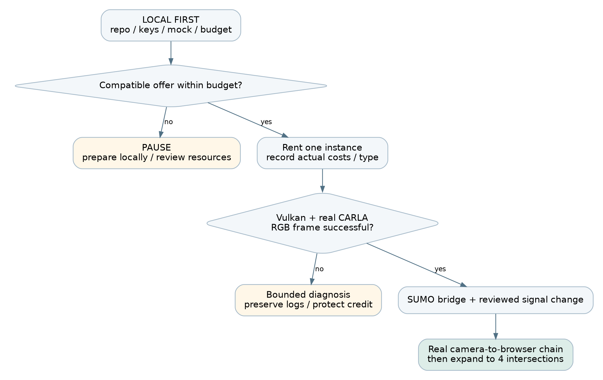

# 02. Protect the $5 credit before doing anything else

Adding credit does not require immediately starting an instance. Prepare the repository, SSH keys, local UI, API accounts, and downloaded documentation first. No instruction in this kit rents or destroys an instance automatically.

Vast pricing is offer-dependent and includes compute, storage, and transfer. Storage continues while a stopped instance exists; bandwidth is separately charged. Check the current offer and billing page instead of treating a quoted GPU hourly rate as the whole bill. [R01]

## Use a spending envelope, not a promise

Proposed allocation: retain $1.00 as an untouchable operating buffer and initially allocate $0.50 for storage/transfer uncertainty. This leaves at most $3.50 for running compute before actual storage rates are added. These allocations are planning assumptions, not provider prices.

| Assumed compute rate | $3.50 compute-only allowance | Meaning |
|---|---|---|
| $0.28/hour | 12.50 hours | Does not include additional storage or transfer |
| $0.30/hour | 11.67 hours | Leaves little room for a 12-hour continuous rental |
| $0.35/hour | 10.00 hours | Requires substantial local preparation |
| $0.40/hour | 8.75 hours | Cannot support a 16-hour continuous run within this allowance |

For a 16-hour continuous rental, $3.50 permits only $0.21875/hour for compute before storage. No suitable offer at that price is guaranteed. A budget shortfall must change paid runtime, scope, or the funding decision; it cannot be solved by assuming free hours.

Use this formula with the actual offer:

```text
remaining_running_hours = max(0,
  (current_credit - future_transfer_allowance - reserve)
  / (compute_per_hour + running_storage_per_hour))
```

Stopped-storage hours and any external model API spending require separate accounting. A provider's displayed combined hourly estimate must not be counted twice: record whether storage is already included. The console balance is authoritative; the supplied estimator is a planning aid and has no auto-stop ability.

```bash
# LOCAL: from starter/; values below are illustrative only.
python -m aegis_helpers.budget --credit 5 --compute 0.30 \
  --storage 0.02 --transfer 0.50 --reserve 1.00
```

## Before clicking Rent

P1 records the starting balance and screenshot of the offer price breakdown. P2 records GPU, allocated CPU/RAM, disk size/rate, ingress/egress rates, rental end time, deployment type, and graphics capability. Agree on a maximum diagnostic allowance, for example $0.50, beyond which you pause and reassess rather than trying random host changes.

A 3D simulator download can be large. Budget the compressed download plus extraction, Python environments, model weights, and logs. A proposed 60-80 GB disk allocation is a planning starting point, not a universal minimum; compare storage cost against measured archive sizes. Do not download extra maps, every YOLO variant, or full benchmark image archives to the GPU host unnecessarily.

## During use and shutdown

Check balance at setup completion, each integration checkpoint, and before rehearsal. Use a phone timer for manual checks. Export small evidence bundles repeatedly. When finished, verify local backups, destroy the unneeded instance through the provider console, and check for retained volumes or other billable resources. Ctrl+C, closing a browser, logging out of SSH, or shutting down the application does not terminate the rental contract. [R01] [R02]

Vast credit does not pay another provider's model API bill. Do not enable paid APIs on the assumption that the $5 covers them. Validate any existing free quota or separately approved API allowance before implementing that route.
# 05. Choose a rental that can render, not merely run CUDA

CARLA 0.9.15 requires an appropriate GPU and uses a Linux/Windows server. Its rendering path uses Vulkan. Off-screen rendering still needs graphics support. A successful CUDA tensor calculation or `nvidia-smi` output alone does not prove that cameras will render. [R05] [R07]

## Preferred selection checklist

Proposed targets: one 24 GB RTX 3090/4090-class GPU, at least 8 allocated CPU threads, roughly 32 GB allocated RAM, and sufficient writable disk after accounting for downloaded archives. These are planning targets, not validated minimum requirements. An offer with a large GPU but very little allocated CPU or RAM can still be unsuitable for this workload.

Select an on-demand instance for demonstration continuity. Check the host's available duration, reliability indicators, location/network quality, allocated resources, and all prices. Never describe on-demand as immune to failures. Capture the offer details before renting. [R03]

## Choose exactly one deployment path

| Path | Use when | How the simulator runs | Key warning |
|---|---|---|---|
| A: Full Linux VM | An affordable VM-compatible offer is available | Native binary or a tested NVIDIA Docker container | More boot/disk overhead; configure SSH keys before launch |
| B: Vast Docker instance | The cheaper verified offer is a container with graphics access | Native CARLA binary inside the existing container, under a non-root user | Do not assume nested Docker/systemd works |

Vast documents both full VMs and Docker-based instances. The VM template is suitable for nested container workflows, whereas the Docker execution environment has different isolation and resource behavior. Check the actual deployment type instead of relying on the template's display name. [R04] [R02]

For a container template, confirm at creation that NVIDIA driver capabilities include the required graphics support. The setting commonly used for this design is `NVIDIA_DRIVER_CAPABILITIES=compute,utility,graphics,video`. The host runtime must expose the corresponding libraries; exporting the variable after creation cannot retroactively mount missing driver libraries. NVIDIA documents the distinction between compute and graphics capabilities. [R09]

## Rental acceptance sequence

1. Select the template and offer; record prices and resource limits.
2. Add team public keys through the supported access method before launch.
3. Rent only after the local checklist is complete.
4. Connect and run the read-only preflight.
5. Verify Vulkan on the assigned NVIDIA device, then obtain a real CARLA camera frame.
6. Reject the environment for this build if graphics cannot be established within the agreed diagnostic allowance.

Do not change host NVIDIA drivers inside a marketplace container. Do not use privileged workarounds blindly. Preserve logs, ask the provider/host for the required capability, or stop further spending while choosing a compatible offer.


# 06. SSH, VS Code, and the team's first connection

Each person creates their own SSH key pair. Share only the public `.pub` file with the account owner. Keep the private key on its owner's laptop and use a passphrase. Do not send the account password, billing credentials, or private key to the group chat. Vast's connection guide explains key-based access and port forwarding. [R06]

```bash
# LOCAL macOS/Linux: choose a fresh filename; do not overwrite an old key.
ssh-keygen -t ed25519 -C "aegis-p2" -f "$HOME/.ssh/aegis_p2"
cat "$HOME/.ssh/aegis_p2.pub"
```

```powershell
# LOCAL Windows PowerShell: use your own teammate identifier.
ssh-keygen -t ed25519 -C "aegis-p2" -f "$HOME/.ssh/aegis_p2"
Get-Content "$HOME/.ssh/aegis_p2.pub"
```

The account owner adds the public keys using the current Vast interface and supported key attachment method. For VMs, Vast documents a pre-launch key requirement; do not wait until after VM creation to configure access. [R04]

## Copy the connection details exactly

Open the instance's Connect/SSH information. Copy its host, port, and username; these are not necessarily the same as the card's IP and port 22. Some offers use an SSH proxy. Preserve the provider's options and proxy configuration rather than simplifying them by guesswork.

```text
LOCAL: ~/.ssh/config example - fill in real values
Host aegis-cloud
    HostName HOST_FROM_VAST_CONNECT
    Port PORT_FROM_VAST_CONNECT
    User USER_FROM_VAST_CONNECT
    IdentityFile ~/.ssh/aegis_p2
    ServerAliveInterval 30
    ServerAliveCountMax 3
```

```bash
# LOCAL: first establish a normal terminal connection.
ssh aegis-cloud
# CLOUD: confirm where you are before running setup commands.
whoami
hostname
pwd
```

Check the host-key fingerprint using available provider/administrator information. Do not disable host-key checking globally to bypass a warning. If the rented host changes after recreation, verify the new host before updating the specific known-host entry.

In VS Code, install Remote SSH, choose Connect to Host, select `aegis-cloud`, and open your own project checkout. The remote editor status indicator must identify the cloud host. Close the remote folder before running commands intended for your laptop. [R23]

## View the private application through an SSH tunnel

Keep the application on cloud loopback initially. Open a second LOCAL terminal:

```bash
ssh -N -L 8000:127.0.0.1:8000 aegis-cloud
```

Open `http://127.0.0.1:8000` on the laptop. Keep that terminal open. The tunnel forwards your local port to the cloud service; it does not start the service. If local port 8000 is busy, use `-L 18000:127.0.0.1:8000` and browse port 18000.

Never expose CARLA RPC, TraCI, model credentials, or administrative fault endpoints directly to the public internet. A remotely accessible judge screen should use an authenticated gateway; the first stage demo can use the operator laptop's tunnel.
# 07. Cloud preflight and Python environment setup

## Read-only checks first

Copy the starter scripts to the cloud or clone the repository. Run the preflight script in the rented Linux environment. Its failure messages are diagnostic, not automatic installation instructions.

```bash
# CLOUD: from starter/.
bash scripts/preflight.sh
```

Acceptance: Linux x86-64, usable GPU/VRAM, enough disk/RAM, and Vulkan enumerating the NVIDIA hardware rather than only a software rasterizer. A headless DISPLAY warning is not automatically fatal; the CARLA RGB frame is the decisive end-to-end graphics test. Record output in `manifests/preflight.txt`.

## Ubuntu 22.04-based native path

These package commands target a Debian/Ubuntu 22.04-based runtime. If `/etc/os-release` says something else, use that distribution's documented packages; do not paste these blindly. In a root container omit `sudo`; in an administrative VM account retain it.

```bash
# CLOUD-ADMIN: install userspace packages, not host GPU drivers.
sudo apt-get update
sudo apt-get install -y git curl ca-certificates unzip tmux \
  python3.10 python3.10-venv python3-pip \
  libvulkan1 vulkan-tools libglib2.0-0 libsm6 libxext6 \
  libxrender1 libxrandr2 libxinerama1 libxcursor1 libxi6 \
  libomp5 libnss3 libasound2 sumo sumo-tools
```

Run the simulator as a non-root account. If the template already provides a suitable non-root user, use it. Otherwise the administrator creates one and an owned workspace. Do not solve permission failures using `chmod -R 777`.

```bash
# CLOUD-ADMIN: run these only when the account is not already present.
sudo useradd --create-home --shell /bin/bash aegisrun
sudo install -d -o aegisrun -g aegisrun /workspace/aegis
sudo -iu aegisrun
```

From a root shell the equivalent account switch is `su - aegisrun`. Shared code may be readable by the runner, but cloud credentials and API keys remain restricted. Do not copy the account owner's entire SSH directory into the runner's home.

## Two cloud environments with explicit interpreter paths

Use two Python 3.10 environments for this private hackathon runtime. Environment membership groups compatible packages; it does not combine the coordinator, detector, API and VQA into one blocking process. CARLA 0.9.15 publishes a CPython 3.10 Linux x86-64 client wheel. The CARLA server and SUMO executable remain separate system programs. [R08] [R12]

| Environment | Install here | Execution rule |
|---|---|---|
| venv-sim | CARLA 0.9.15 client, matched SUMO tools, PyTorch/Ultralytics YOLOv10, FastAPI/Uvicorn; compatible policy code | Separate coordinator, perception, API and rollout processes; only coordinator ticks live CARLA |
| venv-vqa | PyTorch, Transformers/ViLT, Langfuse | Isolated VQA/attack worker; no signal-control credentials |

```bash
# CLOUD-RUNNER: this workspace must already belong to aegisrun.
export AEGIS_HOME=/workspace/aegis
mkdir -p "$AEGIS_HOME/logs" "$AEGIS_HOME/models" "$AEGIS_HOME/manifests"
python3.10 -m venv "$AEGIS_HOME/venv-sim"
python3.10 -m venv "$AEGIS_HOME/venv-vqa"
"$AEGIS_HOME/venv-sim/bin/python" -m pip install --upgrade pip
"$AEGIS_HOME/venv-vqa/bin/python" -m pip install --upgrade pip
export SUMO_HOME=/usr/share/sumo
export PYTHONPATH="$SUMO_HOME/tools:${PYTHONPATH:-}"
sumo --version
```

From the extracted starter folder, set AEGIS_STARTER to its actual path. Install a suitable PyTorch/torchvision pair in each environment using the official PyTorch selector for the chosen host, then install the supplied workload requirements. Do not copy an old MAPPO repository's CUDA pins into the working environment. Ultralytics recommends choosing the PyTorch build before installing its package. [R34]

```bash
# CLOUD-RUNNER: run from the extracted starter folder.
export AEGIS_STARTER="$PWD"
"$AEGIS_HOME/venv-sim/bin/python" -m pip install \
  -r "$AEGIS_STARTER/templates/requirements-sim.in"
"$AEGIS_HOME/venv-vqa/bin/python" -m pip install \
  -r "$AEGIS_STARTER/templates/requirements-vqa.in"
"$AEGIS_HOME/venv-sim/bin/python" -m pip check
"$AEGIS_HOME/venv-vqa/bin/python" -m pip check
"$AEGIS_HOME/venv-sim/bin/python" -c \
  "import carla, traci, ultralytics, fastapi; print('Runtime imports OK')"
```

The requirements are compatibility candidates, not a tested lockfile. The simulation set keeps NumPy below 2 and avoids the newer OpenCV NumPy-2 requirement. Resolve any reported conflict before the first real RGB/YOLO/synchronization smoke test; freeze only the combination that passes. If a training repository cannot share this stack, keep it in P3's existing independent local training setup instead of forcing its dependencies into the live environment.

Save non-secret path exports in a runner-owned aegis_paths.sh file and source it in each new SSH/tmux terminal. Define AEGIS_HOME, AEGIS_STARTER, CARLA_ROOT, CARLA_SOURCE and SUMO_HOME there. Use explicit interpreter paths instead of switching active environments. Keep this legacy-compatible demo private through loopback and SSH; revisit maintained runtime versions before any longer-term deployment. [R08] [R31]

The kit's starter/CLEAN_COMMANDS.md is the copy-paste source. Its scripts/setup_two_envs.sh creates the two environments without installing models or renting anything. Commands use ASCII hyphens, including python3.10 -m venv and sudo useradd --create-home. Run the administrator useradd command only when that account is absent.
# 08. Install and start CARLA 0.9.15

Use the official 0.9.15 release binary or a verified official release image. Do not build Unreal Engine from source during the hackathon. Download the Linux release package using the link exposed by the official release/download page; verify the filename/version before extraction. Extra-map archives are not needed for the initial Town05 attempt. [R05] [R10]

## Path B: binary inside the existing rental container

```bash
# CLOUD-RUNNER: set this to the actual official Linux package URL.
export CARLA_PACKAGE_URL='PASTE_OFFICIAL_0_9_15_LINUX_ARCHIVE_URL'
cd "$AEGIS_HOME"
curl -I -L "$CARLA_PACKAGE_URL"
# Inspect size and remaining budget before downloading.
curl -L --fail --retry 2 -o CARLA_0.9.15.tar.gz "$CARLA_PACKAGE_URL"
mkdir -p "$AEGIS_HOME/carla"
tar -xzf CARLA_0.9.15.tar.gz -C "$AEGIS_HOME/carla"
find "$AEGIS_HOME/carla" -maxdepth 3 -name CarlaUE4.sh
```

Set `CARLA_ROOT` to the directory that actually contains `CarlaUE4.sh`; archive layouts can differ. Do not assume that a Git clone includes the executable. Save the download URL and file hash. Retain only the assets needed for the selected map, without deleting files whose dependencies you do not understand.

```bash
# CLOUD-RUNNER: inside the actual CARLA_ROOT directory.
tmux new -s aegis-carla
./CarlaUE4.sh -RenderOffScreen -quality-level=Low -nosound \
  -carla-rpc-port=2000
```

Detach from tmux with Ctrl+B, then D. Reattach using `tmux attach -t aegis-carla`. Ctrl+C stops the process in that session; it does not stop the rental bill. CARLA's off-screen option renders sensor images without a desktop. No-rendering mode is different and produces empty camera data. [R07]

## Path A: optional official Docker image on a full VM

Only use this path when `docker info` works on the VM and NVIDIA container support has been verified. It is not a command to run blindly inside an ordinary rental container.

```bash
# CLOUD VM: version-pinned image; check graphics support first.
docker pull carlasim/carla:0.9.15
docker run --rm --name aegis-carla --gpus all \
  -e NVIDIA_DRIVER_CAPABILITIES=compute,utility,graphics,video \
  -p 127.0.0.1:2000-2002:2000-2002 \
  carlasim/carla:0.9.15 /bin/bash ./CarlaUE4.sh \
  -RenderOffScreen -quality-level=Low -nosound
```

This is a proposed minimal launch configuration; compatibility must pass the camera smoke test on the selected host. Do not add privileged mode simply because an old example includes it. Consult the exact release's container guidance and provider restrictions when a library/device is missing. [R11] [R09]

## Verify server, map, and one real camera

In another runner terminal, start the explicit client interpreter with "$AEGIS_HOME/venv-sim/bin/python" and enter the Python commands below. Do this before the synchronization coordinator starts:

```python
import carla
client = carla.Client("127.0.0.1", 2000)
client.set_timeout(60)
print(client.get_client_version(), client.get_server_version())
print(client.get_available_maps())
world = client.load_world("Town05")
print(world.get_map().name)
```

Then run `"$AEGIS_HOME/venv-sim/bin/python" scripts/camera_smoke.py --output smoke/camera.png` from the starter in the same environment. This standalone probe requires asynchronous mode and must run before the co-simulation coordinator starts. Open the saved image and verify a plausible rendered street. An empty/black image is a failure to investigate, not a completed perception pipeline.
# 09. SUMO, the co-simulation example, and four real intersections

Obtain the version-matched CARLA source scripts separately if the binary package lacks Co-Simulation. A shallow source checkout is used for scripts, not for compiling the simulator.

```bash
# CLOUD-RUNNER
git clone --depth 1 --branch 0.9.15 \
  https://github.com/carla-simulator/carla.git "$AEGIS_HOME/carla-source"
export CARLA_SOURCE="$AEGIS_HOME/carla-source"
cd "$CARLA_SOURCE/Co-Simulation/Sumo"
"$AEGIS_HOME/venv-sim/bin/python" -m pip install lxml
"$AEGIS_HOME/venv-sim/bin/python" run_synchronization.py --help
```

Resolve missing script dependencies in the simulation environment and record them. CARLA provides examples for Town01, Town04, and Town05. Start with the supplied network and routes rather than importing a new city. Pin the SUMO version that passes your smoke test and use that same version for the training/evaluation network. [R12] [R13]

## First synchronized run

Load Town05 in CARLA before starting the example. Do not start a second traffic generator independently in CARLA. Let SUMO own the vehicles used in the experiment, and let the bridge mirror them into CARLA.

```bash
# CLOUD-RUNNER: CARLA already running with Town05 loaded.
cd "$CARLA_SOURCE/Co-Simulation/Sumo"
"$AEGIS_HOME/venv-sim/bin/python" run_synchronization.py examples/Town05.sumocfg \
  --tls-manager sumo --step-length 0.05
```

Do not add `--sumo-gui` on a headless host unless you deliberately configured a display. `--tls-manager sumo` matters: the script's default does not synchronize the traffic-light authority. [R12]

The example is the smoke-test coordinator. For the actual app, P2 must extend or wrap its tick cycle with an observation/action hook. Do not run both the example and a second controller loop that independently advances CARLA or SUMO.

## Inventory the traffic lights independently

Stop the smoke-test coordinator cleanly. Run the included inventory script in its own SUMO process:

```bash
# CLOUD-RUNNER: no connection to the live co-simulation is used.
"$AEGIS_HOME/venv-sim/bin/python" /PATH/TO/starter/scripts/list_tls.py \
  "$CARLA_SOURCE/Co-Simulation/Sumo/examples/Town05.sumocfg" \
  --out tls_inventory.json
```

SUMO's traffic-light API exposes controlled lanes, programs, and phase states. Review actual geometry and connectivity, not just the number of returned IDs. One signal ID can control more than one physical location; verify what you are counting. [R14]

Populate `configs/junctions.json` with four selected signal IDs, lane IDs, neighbor links, camera transforms, approved green actions, and validated transition paths. The provided example file intentionally contains replacement markers. No production run should start while those markers remain.

## Readiness test

For each of the four intersections: vehicles arrive on declared routes, an approved phase can be selected through the single coordinator, the phase is visible in both simulators, the camera covers the required approaches, and a recorded timestamp connects its image to the traffic state. If Town05 cannot supply the chosen connected topology within the build, evaluate another supplied example and record the map change before training.
# 10. The first end-to-end acceptance gate

Do not start embellishing the dashboard until this gate passes. It is the fastest way to discover whether the rented platform and integration choices are usable.

| Step | Action | Evidence to save | Failure means |
|---|---|---|---|
| 1 | Start CARLA, connect exact-version API | Server/client versions and log | Runtime not ready |
| 2 | Capture one RGB frame | Real PNG with frame ID/time | Rendering not ready |
| 3 | Detect vehicles in that frame | Boxes/classes plus inference time | Perception not ready |
| 4 | Advance supplied SUMO/CARLA example | Synchronized timestamp/vehicle sample | Bridge not ready |
| 5 | Request a reviewed phase transition | Accepted action + resulting signal state | Actuation not ready |
| 6 | Stream the frame and state to a browser | LIVE-labeled console evidence | Presentation transport not ready |

Use fixed-time control for this integration test. Its purpose is to validate transport and actuation, not prove learned control. Keep `controller_type=fixed_time` in every event until a real checkpoint is loaded.

## YOLOv10 installation and first inference

Use the maintained Ultralytics package in venv-sim and its YOLO class for yolov10n.pt. Do not install the original YOLOv10 repository fork into the same environment. Keep the actual checkpoint, package version and license in the manifest. [R16] [R33] [R34]

```bash
# CLOUD-RUNNER: requirements-sim.in is installed in section 7.
"$AEGIS_HOME/venv-sim/bin/python" -c \
  "import torch; print(torch.__version__, torch.cuda.is_available())"
# Run from starter/ after camera_smoke.py has saved smoke/camera.png.
"$AEGIS_HOME/venv-sim/bin/python" - <<'PYCODE'
from ultralytics import YOLO
model = YOLO("yolov10n.pt")
results = model("smoke/camera.png")
print(results[0].boxes)
PYCODE
```

The first model load may download weights and consume transfer/storage. A frame with no detections may simply contain no vehicles; inspect it and test a known positive frame. A detection image is not yet a validated lane-queue estimate. Use section 12 for that work.

Run inference in a bounded latest-frame worker beside CARLA. Keep the single coordinator, perception worker and FastAPI process separate even though they share venv-sim. Do not put hosted VQA, model downloads or long neural inference inside a simulation tick. Publish compressed frames and structured telemetry; measure their delay on the actual demo laptop. [R15]

After both real smoke paths pass, save exact installed versions:

```bash
"$AEGIS_HOME/venv-sim/bin/python" -m pip freeze \
  > "$AEGIS_HOME/manifests/requirements-sim.lock.txt"
"$AEGIS_HOME/venv-vqa/bin/python" -m pip freeze \
  > "$AEGIS_HOME/manifests/requirements-vqa.lock.txt"
```
# 27. Backup, reset, shutdown, and cost recovery

## Save these files repeatedly

The current code commit, map/junction configuration, camera calibration, action mappings, model checkpoint and normalization, version manifest, evaluation CSV/JSON, decision/incident logs, selected screenshots, and one labeled recording. Do not include API keys, private SSH keys, raw personal data, or unnecessary frame archives.

```bash
# CLOUD: from the real project root.
bash scripts/export_bundle.sh aegis_evidence.tar.gz
# Inspect filenames and size before copying.
tar -tzf aegis_evidence.tar.gz | head
ls -lh aegis_evidence.tar.gz
```

```bash
# LOCAL: download using your configured SSH host alias.
scp aegis-cloud:/ACTUAL/PATH/aegis_evidence.tar.gz .
```

Use the actual path, not an assumed `/workspace` location. Verify the archive opens locally and contains the checkpoint, manifests, and recent metrics. Keep a second teammate's copy. An uploaded Git commit does not contain ignored weights or result files unless you explicitly transferred them.

## Rehearsal reset checklist

P2 announces RESETTING. Stop the coordinator and separate worker processes by their owned session/process IDs. Close TraCI connections; destroy owned sensors/actors; reload the approved map/scenario; restore fixed settings; clear pending proposals; create a fresh run ID; restart perception/control; validate a health snapshot. Do not reuse an action from the previous run.

Run this reset at least twice before judging. Record wall time. P4's speech includes a short sentence that can cover an ordinary reset rather than pretending it is instantaneous.

## End the bill deliberately

After backup verification, use the Vast console to stop or destroy according to the planned lifecycle. Destroying deletes instance data and is irreversible. Check that the intended instance is removed and that no retained volume or second instance remains. Stopped instances can still incur storage charges; do not rely on an empty credit balance as a safe cleanup policy. [R01] [R02]

No script in this kit automatically destroys resources, changes billing settings, or purchases another instance. The account owner makes that decision explicitly after verifying backups.

## An affordable development habit

Keep the zero-cost fixture dashboard and helper tests usable throughout the build. When the cloud is unavailable, P4 can continue UI work, P1 can finish slides, and P3 can analyze exported logs or train in local SUMO. Mark each mode accurately. Development independence is what prevents the $5 credit from becoming the team's only productive clock.
